# Projet Finale

**Étudiant : MANAI Mohamed Amine**  
**Projet : GameMart — application e-commerce de jeux vidéo**  
**Site déployé : [https://gamemarttn.netlify.app/](https://gamemarttn.netlify.app/)**  
**Date : octobre – novembre 2026 (Version Finale Enrichie)**  

> **Cadre du Projet Final :** Étude préalable complète du site, définition des personas, recherche approfondie de mots-clés, audit SEO technique et sémantique sur site réel, configuration pas à pas des outils officiels Google (**Google Tag Manager**, **Google Analytics 4**, **Google Search Console**), explications techniques et fonctionnelles approfondies du fonctionnement des **Sitemaps** et de **Robots.txt**, intégration du tracking e-commerce dans le code source Angular, tableau complet des événements réels avec preuves en captures d'écran, et feuille de route Digital Marketing / KPI.
> 
> **Outils utilisés et vérifiés :** Google Search Console, Google Analytics 4, Google Tag Manager, Screaming Frog SEO Spider 24.3, Google PageSpeed Insights, MozBar, navigateur Edge.

---

## Sommaire

1. [Étude préalable du site](#1-étude-préalable-du-site)
2. [Personas](#2-personas)
3. [Recherche de mots-clés](#3-recherche-de-mots-clés)
4. [Audit SEO du site existant](#4-audit-seo-du-site-existant)
5. [Comprendre les Fondations SEO : Sitemap XML et Robots.txt](#5-comprendre-les-fondations-seo--sitemap-xml-et-robotstxt)
6. [Configuration Pas à Pas des Outils Google (GTM, GA4, GSC)](#6-configuration-pas-à-pas-des-outils-google-gtm-ga4-gsc)
7. [Implémentation du Tracking dans le Code Source (Angular 20)](#7-implémentation-du-tracking-dans-le-code-source-angular-20)
8. [Tableau Récapitulatif des Événements Analytics Réalisés](#8-tableau-récapitulatif-des-événements-analytics-réalisés)
9. [Preuves d'Implémentation & Résultats Réels (Captures d'Écran)](#9-preuves-dimplémentation--résultats-réels-captures-décran)
10. [Stratégie SEO à mettre en place](#10-stratégie-seo-à-mettre-en-place)
11. [KPI, Plan d'action et Roadmap](#11-kpi-plan-daction-et-roadmap)
12. [Conclusion](#12-conclusion)
13. [Annexes](#13-annexes)

---

## 1. Étude préalable du site

### 1.1. Présentation du projet
**GameMart** est une application e-commerce moderne dédiée à la **vente de jeux vidéo sur PC**.  
Technologies : Angular 20, TypeScript, RxJS, SCSS, API mock JSON Server.  
Fonctionnalités réelles du site :
- Page d'accueil avec bannières de promotions dynamiques, nouveautés et exploration par catégories.
- Catalogue interactif `/produits` filtrable et triable (par catégorie, fourchette de prix, note des utilisateurs, nouveautés, popularité).
- Fiches produits détaillées `/produitDetails/:id` comprenant description complète, carrousel d'images, trailer YouTube officiel intégré, note, stock et suggestions de jeux similaires.
- Recherche instantanée avec page de résultats `/search`.
- Panier complet avec gestion de quantité, sauvegarde locale et calcul des frais de livraison.
- Tunnel de commande (Checkout) avec contrôle des étapes, sélection du mode de livraison et paiement fictif.
- Espace utilisateur complet (profil, gestion des adresses, historique des commandes, wishlist / liste de souhaits).
- Le catalogue compte **40 jeux PC complets** (Cyberpunk 2077, Red Dead Redemption 2, Elden Ring, Baldur's Gate 3, etc.).
- Le site est déployé en production et accessible publiquement sur Netlify : `https://gamemarttn.netlify.app/`.

### 1.2. Problème, solution et proposition de valeur
- **Problème :** Les joueurs PC perdent un temps précieux à comparer des dizaines de plateformes pour trouver un jeu au juste prix, sans certitude sur la configuration minimale requise. De plus, les acheteurs non-joueurs (parents voulant offrir un cadeau) sont rapidement découragés par le jargon technique (genres, PEGI, configurations GPU/CPU).
- **Solution :** GameMart simplifie radicalement le parcours client : filtres limpides, fiches de jeu enrichies (trailers, avis, configurations), tunnel d'achat sans friction et gestion de wishlist.
- **Proposition de valeur :** Découvrir, comparer et acheter en toute confiance un jeu PC au meilleur prix grâce à une interface épurée, des fiches multimédias et une sélection ciblée.

### 1.3. Public cible et besoins
- **Cœur de cible :** 16-35 ans, joueurs PC francophones (France, Belgique, Suisse, Tunisie / Maghreb francophone), très attentifs aux promotions et bons plans, actifs sur Discord, YouTube et TikTok.
- **Cible secondaire :** Parents et proches (25-50 ans) recherchant un cadeau fiable sans maîtriser le vocabulaire gaming.
- **Besoins majeurs :** Prix transparents, promos en avant, avis fiables, aperçu vidéo immédiat, sécurité lors du paiement et livraison instantanée/rapide.

### 1.4. Positionnement digital, objectifs, canaux, opportunités et risques
- **Positionnement :** Spécialiste agile « catalogue malin + fiches immersives + bons plans », capitalisant sur la longue traîne et le conseil personnalisé plutôt que sur la guerre frontale des volumes contre Steam ou Epic Games Store.
- **Objectifs SEO :** Indexation totale des fiches produits, top 20 sur 10 fiches pilotes à M6, positionnement de la page `/produits` et des futures catégories sur les requêtes à forte intention commerciale.
- **Objectifs Marketing :** Tracer 100 % du tunnel de conversion (de la vue produit jusqu'à l'achat validé), animer une communauté de gamers fidèles et tester des micro-campagnes publicitaires rentables.
- **Canaux privilégiés :** SEO / Content Marketing, Google Search, YouTube (démos et trailers), TikTok / Instagram (clips courts et bons plans), Emailing (relance panier et promotions).
- **Risques identifiés :** Rendu 100 % côté client (SPA Angular) pouvant ralentir l'exploration par les robots, autorité de domaine naissante, concurrence féroce des plateformes historiques de clés de jeux.

---

## 2. Personas

### Persona 1 — Yanis, 21 ans, étudiant gamer à budget serré
- **Profil :** Étudiant universitaire, consacre 10 à 15 heures par semaine au gaming sur PC portable optimisé.
- **Objectifs :** Obtenir ses jeux préférés au prix le plus bas possible, ne manquer aucune promotion temporaire, lister ses futurs achats sur sa wishlist.
- **Frustrations :** Prix de lancement trop élevés (70 €+), coûts cachés au moment de payer, manque de trailers directs sur les boutiques de clés.
- **Comportement digital :** Recherche sur Google (« acheter jeu PC pas cher »), regarde des tests sur YouTube, échange des bons plans sur des serveurs Discord.
- **Intentions de recherche :** Transactionnelles et commerciales directes.

### Persona 2 — Salma, 34 ans, mère offrant un jeu en cadeau
- **Profil :** Cadre en entreprise, ne joue pas aux jeux vidéo, souhaite offrir un jeu pour l'anniversaire de son fils de 14 ans.
- **Objectifs :** Trouver rapidement un jeu populaire adapté à l'âge de son fils sans faire d'erreur, passer commande simplement et recevoir une facture claire.
- **Frustrations :** Jargon incompréhensible, peur d'acheter un jeu trop violent ou incompatible, service client absent.
- **Comportement digital :** Recherche en langage naturel sur smartphone (« quel jeu vidéo offrir adolescent 2026 »), consulte les avis clients.
- **Intentions de recherche :** Informationnelles au départ, se transformant en transactionnelles dès que la réassurance est acquise.

### Persona 3 — Mehdi, 27 ans, passionné PC exigeant et méthodique
- **Profil :** Ingénieur système, joueur assidu disposant d'une configuration haut de gamme (RTX 4080).
- **Objectifs :** Vérifier les aspects techniques d'un jeu (moteur, framerate, compatibilité) avant d'acheter, comparer les notes de la critique.
- **Frustrations :** Fiches techniques incomplètes, absence de vidéos in-game, manque de clarté sur les éditions (Standard vs Deluxe).
- **Comportement digital :** Fréquente Reddit, forums spécialisés, tape des requêtes de comparaison très pointues (« test cyberpunk 2077 pc avis 2026 »).
- **Intentions de recherche :** Commerciales expertes et comparatives.

---

## 3. Recherche de mots-clés

La recherche a été calibrée sur les intentions des 3 personas et cartographiée sur les URL réelles du site. Les 38 mots-clés détaillés sont consignés dans `docs/seo-keywords.csv`.

### 3.1. Tableau synthétique des mots-clés prioritaires

| Mot-clé | Type d'intention | Persona cible | Page de destination | Priorité |
|---|---|---|---|---|
| **acheter jeux vidéo en ligne** | Transactionnelle (TRA) | Yanis, Salma | `/produits` | P0 (Critique) |
| **boutique jeux vidéo en ligne** | Commerciale / TRA | Yanis, Salma | `/` (Accueil) | P0 (Critique) |
| **jeux vidéo pas cher** | TRA / Commerciale | Yanis | `/produits` + filtre promo | P0 (Critique) |
| **acheter [Nom du Jeu] PC** (ex: Cyberpunk 2077) | Transactionnelle | Yanis, Mehdi | `/produitDetails/:id` | P0 (Critique) |
| **jeu RPG PC / monde ouvert** | Commerciale (COM) | Yanis, Mehdi | `/produits` (Facettes catégories) | P1 (Haute) |
| **quel jeu vidéo offrir ado** | Informationnelle (INF) | Salma | Blog / Guide cadeaux | P1 (Haute) |
| **avis jeu PC 2026** | COM / INF | Mehdi | Fiches produits + Blog | P1 (Haute) |
| **gamemart** | Navigationnelle (NAV) | Tous | `/` | P0 (Marque) |

### 3.2. Stratégie de longue traîne
La longue traîne représente l'opportunité majeure pour GameMart face aux leaders du marché :
- Requêtes très précises à fort taux de conversion : *« acheter cyberpunk 2077 pc cle steam pas cher »*, *« jeu de rôle aventure pc premier achat »*.
- Moindre concurrence SEO : permet un positionnement rapide en première page de Google sans nécessiter un profil de liens massif.

---

## 4. Audit SEO du site existant

L'audit technique initial a été réalisé avec **Screaming Frog SEO Spider 24.3** sur l'ensemble des 42 URLs du site, couplé à **Google PageSpeed Insights** et **MozBar**.

### 4.1. Synthèse des résultats d'audit technique

| Élément analysé | Constat sur le site initial | Impact sur le référencement | Action corrective menée / recommandée |
|---|---|---|---|
| **Rendu SPA (Angular)** | Rendu exécuté uniquement dans le navigateur (client-side). En crawl brut sans JS, les balises `<h1>` et images sont invisibles. | Risque que Googlebot indexe mal le contenu dynamique lors des premiers passages. | Pré-rendu statique des routes ou SSR (`@angular/ssr`). |
| **Balise `<title>`** | Title identique sur les 42 pages : `<title>ECommerce</title>`. | **Critique :** Google ne peut pas différencier les jeux, taux de clic (CTR) quasi nul. | Mise en place d'un `TitleStrategy` dynamique dans Angular pour générer un titre unique par jeu. |
| **Meta Description** | Absente sur 100 % des pages (42/42 manquantes). | **Haute :** Les snippets dans la recherche affichent du texte aléatoire au lieu d'une phrase d'accroche commerciale. | Ajout de balises meta description personnalisées de 150-160 caractères sur chaque route. |
| **Balise Canonical** | Manquante sur l'ensemble des 42 pages auditées. | **Moyenne :** Risque de contenu dupliqué si des paramètres d'URL (tri, filtres) sont explorés. | Ajout systématique d'une balise `<link rel="canonical">` pointant vers l'URL propre. |
| **Fichiers d'indexation** | Aucun fichier `robots.txt` ni `sitemap.xml` n'existait au départ. | Découverte lente des nouvelles pages et crawl anarchique des pages privées. | **Résolu :** Création et déploiement de `robots.txt` et `sitemap.xml` (42 URLs) dans `/public`. |
| **Performance (PageSpeed)** | Score mobile de 45 sur fiche produit, LCP à 15,6s dû à des images externes non compressées. | Mauvaise expérience utilisateur et pénalité dans l'algorithme Core Web Vitals de Google. | Hébergement local des visuels, conversion en format WebP et application du lazy-loading. |
| **Autorité (MozBar)** | Domain Authority hérité de Netlify (DA 93) mais **0 lien propre** vers GameMart. | Autorité réelle nulle au démarrage nécessitant une vraie stratégie d'acquisition. | Stratégie de netlinking ciblée et partenariats micro-influenceurs. |

---

## 5. Comprendre les Fondations SEO : Sitemap XML et Robots.txt

Pour qu'un site apparaisse dans Google, deux questions fondamentales se posent :
1. *Quelles pages les robots ont-ils le droit de visiter ?* — C'est le rôle du **Robots.txt**.
2. *Où se trouvent toutes les pages importantes et quand ont-elles été modifiées ?* — C'est le rôle du **Sitemap XML**.

**Processus séquentiel d'exploration par les robots :**
1. **Arrivée de Googlebot** sur le domaine racine `https://gamemarttn.netlify.app/`.
2. **Consultation impérative de `/robots.txt`** pour vérifier les autorisations d'exploration.
3. Si la page est interdite (`Disallow: /cart`, `/checkout`...), l'exploration s'arrête immédiatement afin de préserver le budget de crawl.
4. Si la page est autorisée (`Allow: /`), Googlebot consulte le lien officiel vers `/sitemap.xml`.
5. **Découverte intégrale des 42 URLs du catalogue** fournies par le sitemap XML.
6. **Crawl, exécution du rendu JS et indexation** dans Google Search Console.

### 5.1. Qu'est-ce que le fichier `robots.txt` et à quoi sert-il ?
Le fichier `robots.txt` est un fichier texte brut placé obligatoirement à la racine d'un site web (ex : `https://gamemarttn.netlify.app/robots.txt`). Il s'agit du **premier fichier consulté par les robots d'indexation** (Googlebot, Bingbot).

#### Pourquoi est-il indispensable ?
- **Protéger les données privées et tunnels d'achat :** Des pages comme le panier (`/cart`), la finalisation de commande (`/checkout`) ou le compte client (`/user`) ne contiennent aucune information pertinente pour les internautes sur Google. Pire, les indexer gaspillerait les ressources du robot.
- **Économiser le budget de crawl (Crawl Budget) :** Google n'accorde qu'un temps limité à chaque site web. En lui interdisant les pages inutiles ou les résultats de recherche interne (`/search`), on force le robot à concentrer ses efforts sur les fiches produits et le catalogue.
- **Indiquer l'adresse du Sitemap :** Il fournit directement le lien vers la carte complète du site.

#### Extrait réel déployé sur GameMart (`public/robots.txt`) :
```text
User-agent: *
Allow: /
Allow: /assets/

# Protection des pages privées et transactionnelles
Disallow: /cart
Disallow: /checkout
Disallow: /order-confirmation/
Disallow: /user/
Disallow: /login
Disallow: /register

# Éviter le crawl de la recherche dynamique (évite le contenu dupliqué)
Disallow: /search

# API backend
Disallow: /api/

# Déclaration officielle du Sitemap pour Googlebot
Sitemap: https://gamemarttn.netlify.app/sitemap.xml
```

### 5.2. Qu'est-ce que le fichier `sitemap.xml` et à quoi sert-il ?
Le `sitemap.xml` est un fichier au format XML qui dresse la **liste exhaustive de toutes les URLs publiques d'un site que l'on souhaite voir indexées dans Google**.

#### Pourquoi est-il indispensable ?
- **Accélérer la découverte des pages :** Sans sitemap, Google doit suivre les liens un par un. Pour une application Angular avec 40 jeux, le sitemap permet à Google d'obtenir instantanément la liste des 42 pages clés (Accueil, Catalogue, 40 Fiches produits).
- **Indiquer la fraîcheur des contenus (`<lastmod>`) :** Informe Google de la date de dernière modification pour qu'il sache quand revisiter la page.
- **Définir la priorité relative (`<priority>`) :** Signale quelles pages sont capitales (ex: 1.0 pour l'accueil, 0.9 pour le catalogue, 0.8 pour les fiches jeux).

#### Extrait réel déployé sur GameMart (`public/sitemap.xml`) :
```xml
<?xml version="1.0" encoding="UTF-8"?>
<urlset xmlns="http://www.sitemaps.org/schemas/sitemap/0.9">
  <!-- Page d'accueil -->
  <url>
    <loc>https://gamemarttn.netlify.app/</loc>
    <lastmod>2026-10-08</lastmod>
    <changefreq>daily</changefreq>
    <priority>1.0</priority>
  </url>
  <!-- Catalogue général -->
  <url>
    <loc>https://gamemarttn.netlify.app/produits</loc>
    <lastmod>2026-10-08</lastmod>
    <changefreq>daily</changefreq>
    <priority>0.9</priority>
  </url>
  <!-- Fiche produit pilote : Cyberpunk 2077 -->
  <url>
    <loc>https://gamemarttn.netlify.app/produitDetails/1</loc>
    <lastmod>2026-10-08</lastmod>
    <changefreq>weekly</changefreq>
    <priority>0.8</priority>
  </url>
  <!-- ... suite des 40 fiches jeux réelles du catalogue -->
</urlset>
```

---

## 6. Configuration Pas à Pas des Outils Google (GTM, GA4, GSC)

Pour piloter efficacement le SEO et l'analyse d'audience, trois outils Google complémentaires ont été installés et connectés entre eux :

| Outil Google | Rôle principal | Identifiant du projet GameMart |
|---|---|---|
| **Google Tag Manager (GTM)** | Gestionnaire centralisé de balises (évite de modifier le code à chaque nouvel outil marketing). | `GTM-K5CGZVQZ` |
| **Google Analytics 4 (GA4)** | Analyse du trafic, mesure de l'engagement des utilisateurs et des ventes e-commerce. | `G-ZJG88C90B2` |
| **Google Search Console (GSC)** | Contrôle de la visibilité sur le moteur Google, suivi des requêtes, indexation et sitemaps. | Propriété : `https://gamemarttn.netlify.app/` |

**Flux de transmission des données :**
- L'internaute effectue une action sur GameMart $\rightarrow$ L'application pousse les données dans le `window.dataLayer`.
- Google Tag Manager (`GTM-K5CGZVQZ`) intercepte ces événements grâce à ses déclencheurs et les redirige vers la balise Google Analytics 4 (`G-ZJG88C90B2`).

---

### 6.1. Étape 1 : Configuration de Google Tag Manager (GTM)

#### Procédure de configuration pas à pas :
1. **Création du compte et du conteneur :** Rendez-vous sur `tagmanager.google.com`. Créer un compte « GameMart » et un conteneur de type **Web** ciblant `gamemarttn.netlify.app`. L'identifiant généré est **`GTM-K5CGZVQZ`**.
2. **Installation du code conteneur dans l'application :**
   Insérer le script d'initialisation dans l'entête `<head>` du fichier `src/index.html` :
   ```html
   <!-- Google Tag Manager -->
   <script>(function(w,d,s,l,i){w[l]=w[l]||[];w[l].push({'gtm.start':
   new Date().getTime(),event:'gtm.js'});var f=d.getElementsByTagName(s)[0],
   j=d.createElement(s),dl=l!='dataLayer'?'&l='+l:'';j.async=true;j.src=
   'https://www.googletagmanager.com/gtm.js?id='+i+dl;f.parentNode.insertBefore(j,f);
   })(window,document,'script','dataLayer','GTM-K5CGZVQZ');</script>
   <!-- End Google Tag Manager -->
   ```
   Et la balise de secours `<noscript>` immédiatement après l'ouverture de `<body>` :
   ```html
   <noscript><iframe src="https://www.googletagmanager.com/ns.html?id=GTM-K5CGZVQZ"
   height="0" width="0" style="display:none;visibility:hidden"></iframe></noscript>
   ```
3. **Création de la Balise Google Analytics (Destination Google) :**
   - Dans le menu **Balises**, cliquer sur *Nouvelle*.
   - Type de balise : **Balise Google** (Google Analytics).
   - ID de mesure : `G-ZJG88C90B2`.
   - Déclencheur : *Initialization - All Pages* et *All Pages* pour capter chaque chargement de page.
4. **Configuration des Déclencheurs (Triggers) :**
   Pour capturer les événements personnalisés venant du site, nous avons configuré les déclencheurs natifs : *Page vue*, *DOM prêt*, *Fenêtre chargée*, *Liens uniquement*, *Tous les éléments*, et les événements personnalisés.
5. **Publication des versions :**
   Cliquer sur **Envoyer** pour publier le conteneur. La **Version 3** est actuellement active et en ligne (2 balises, 7 déclencheurs).

---

### 6.2. Étape 2 : Configuration de Google Analytics 4 (GA4)

#### Procédure de configuration pas à pas :
1. **Création du flux de données Web :**
   - Sur `analytics.google.com`, créer la propriété « GameMart Web ».
   - Ajouter un flux de données Web pointant vers `https://gamemarttn.netlify.app`.
   - Noter le numéro de flux (Measurement ID) : **`G-ZJG88C90B2`**.
2. **Mesure améliorée (Enhanced Measurement) :**
   Activer la détection automatique des défilements (*scroll*), clics sortants, recherches sur le site et engagement vidéo.
3. **Double intégration de sécurité :**
   Pour garantir la capture des données même si un bloqueur retarde GTM, le snippet `gtag.js` direct a également été déclaré dans `src/index.html` :
   ```html
   <!-- Google Analytics GA4 (gtag.js) -->
   <script async src="https://www.googletagmanager.com/gtag/js?id=G-ZJG88C90B2"></script>
   <script>
     window.dataLayer = window.dataLayer || [];
     function gtag(){dataLayer.push(arguments);}
     gtag('js', new Date());
     gtag('config', 'G-ZJG88C90B2');
   </script>
   ```
4. **Vérification dans le rapport « Temps réel » :**
   En ouvrant le site et en effectuant des actions (ajout au panier, consultation d'un jeu), les événements remontent instantanément dans l'interface GA4 (voir captures §9).

---

### 6.3. Étape 3 : Configuration de Google Search Console (GSC)

#### Procédure de configuration pas à pas :
1. **Ajout de la propriété :**
   - Se connecter sur `search.google.com/search-console`.
   - Choisir le type de propriété **Préfixe de l'URL** : `https://gamemarttn.netlify.app/`.
2. **Validation de la propriété :**
   - La validation est automatique et instantanée grâce au tag Google Analytics / Google Tag Manager déjà détecté sur le site sous le même compte Google (`aminemanai222@gmail.com`).
3. **Soumission officielle du Sitemap XML :**
   - Dans le menu latéral gauche, cliquer sur **Sitemaps**.
   - Saisir `sitemap.xml` dans le champ « Ajouter un sitemap » et valider.
   - Statut obtenu : **« Opération effectuée »** avec **42 pages découvertes**.
4. **Inspection d'URL et Test en direct :**
   - Tester l'URL racine `https://gamemarttn.netlify.app/`.
   - Résultat du test en ligne : **« Google a accès à cette URL »**, page indexable avec capture d'écran mobile réussie montrant la boutique GameMart opérationnelle.

---

## 7. Implémentation du Tracking dans le Code Source (Angular 20)

Pour respecter les standards recommandés par Google pour le e-commerce (norme GA4 Recommended Events), nous avons créé un service Angular dédié : `AnalyticsService` (`src/app/services/analytics.service.ts`).

### 7.1. Le Service Centralisé : `AnalyticsService`
Ce service gère à la fois le suivi des changements de page dans une Single Page Application (SPA) et l'envoi des événements e-commerce normalisés.

```typescript
// Extrait de src/app/services/analytics.service.ts
import { Injectable, inject } from '@angular/core';
import { Router, NavigationEnd } from '@angular/router';
import { filter } from 'rxjs/operators';
import { environment } from '../../environments/environment';

declare global {
  interface Window {
    dataLayer: any[];
    gtag: (...args: any[]) => void;
  }
}

@Injectable({ providedIn: 'root' })
export class AnalyticsService {
  private router = inject(Router);
  private gaId = environment.googleAnalyticsId;      // G-ZJG88C90B2
  private gtmId = environment.googleTagManagerId;    // GTM-K5CGZVQZ

  init(): void {
    if (typeof window === 'undefined') return;
    window.dataLayer = window.dataLayer || [];

    // Suivi automatique des pages vues lors de la navigation Angular
    this.trackPageView(this.router.url || '/');
    this.router.events
      .pipe(filter((e) => e instanceof NavigationEnd))
      .subscribe((e: NavigationEnd) => {
        this.trackPageView(e.urlAfterRedirects);
      });
  }

  trackPageView(path: string): void {
    if (typeof window === 'undefined') return;
    // Notification GA4 direct
    if (this.gaId && typeof window.gtag === 'function') {
      window.gtag('config', this.gaId, { page_path: path });
    }
    // Notification GTM via dataLayer
    if (this.gtmId) {
      window.dataLayer.push({
        event: 'page_view',
        page_path: path,
        page_location: window.location.origin + path,
        page_title: document.title
      });
    }
  }

  trackEvent(name: string, params?: Record<string, any>): void {
    if (typeof window === 'undefined') return;
    const payload = { ...(params || {}) };

    // Formatage plat pour affichage temps réel dans GA4
    const items = payload['items'];
    if (Array.isArray(items) && items.length > 0) {
      payload['item_name'] = items.map((i: any) => i?.item_name).filter(Boolean).join(', ');
      payload['item_id'] = items.map((i: any) => i?.item_id).join(', ');
    }

    if (this.gaId && typeof window.gtag === 'function') {
      window.gtag('event', name, payload);
    }
    if (this.gtmId) {
      window.dataLayer.push({ event: name, ...payload });
    }
  }
}
```

### 7.2. Extraits de code de déclenchement des événements dans les composants

#### 1. Ajout au panier (`src/app/services/cart.service.ts`)
```typescript
this.analytics.trackEvent('add_to_cart', {
  currency: 'EUR',
  value: game.price,
  items: [{
    item_id: game.id,
    item_name: game.title,
    price: game.price,
    quantity: 1
  }]
});
```

#### 2. Consultation d'une fiche produit (`src/app/components/produit-details/produit-details.ts`)
```typescript
this.analytics.trackEvent('view_item', {
  currency: 'EUR',
  value: game.price,
  items: [{
    item_id: game.id,
    item_name: game.title,
    item_category: game.category,
    price: game.price
  }]
});
```

#### 3. Tunnel de commande et validation d'achat (`src/app/components/checkout/checkout.ts`)
```typescript
// Début du tunnel de commande
this.analytics.trackEvent('begin_checkout', {
  currency: 'EUR',
  value: this.total,
  items: this.cartItems
});

// Confirmation finale d'achat (Purchase)
this.analytics.trackEvent('purchase', {
  transaction_id: orderId,
  value: this.total,
  currency: 'EUR',
  shipping: this.selectedShippingCost,
  items: this.cartItems
});
```

---

## 8. Tableau Récapitulatif des Événements Analytics Réalisés

Voici l'ensemble des événements configurés, reliés au code source et testés avec succès :

| Événement GA4 standard | Fichier source Angular | Action déclenchante de l'utilisateur | Paramètres transmis | Statut vérifié |
|---|---|---|---|---|
| `page_view` | `analytics.service.ts` | Navigation sur n'importe quelle route (Accueil, Catalogue, Fiche...) | `page_path`, `page_title`, `page_location` | **Actif** (15+ vus en temps réel) |
| `view_item_list` | `produits.ts` | Arrivée sur la page catalogue `/produits` | `item_list_name: 'Catalogue'`, `items[]` | **Actif** |
| `select_item` | `produits.ts`, `search.ts` | Clic sur la vignette d'un jeu pour ouvrir sa fiche | `item_id`, `item_name`, `price` | **Actif** |
| `view_item` | `produit-details.ts` | Affichage complet de la fiche produit `/produitDetails/:id` | `item_id`, `item_name`, `item_category`, `value` | **Actif** (visible en capture) |
| `add_to_cart` | `cart.service.ts` | Clic sur le bouton « Ajouter au panier » | `currency`, `value`, `items` (id, nom, prix, qté) | **Actif** (5 déclenchements prouvés) |
| `add_to_wishlist` | `produit-details.ts`, `produits.ts` | Clic sur le cœur pour sauvegarder un jeu en favoris | `item_id`, `item_name`, `price` | **Actif** |
| `search` | `search.ts` | Saisie et validation d'un terme dans la barre de recherche | `search_term` | **Actif** |
| `view_search_results` | `search.ts` | Affichage des résultats filtrés par la recherche | `search_term`, `items[]` | **Actif** |
| `begin_checkout` | `checkout.ts` | Accès à la page de commande `/checkout` avec un panier | `value`, `currency`, `items[]` | **Actif** |
| `add_payment_info` | `checkout.ts` | Sélection du mode de paiement (Carte bancaire ou à la livraison) | `payment_type`, `value`, `currency` | **Actif** |
| `purchase` | `checkout.ts` | Clic sur « Confirmer la commande » et validation | `transaction_id`, `value`, `currency`, `shipping`, `items[]` | **Actif** |
| `scroll` | Détection GA4 automatique | Défilement à plus de 90 % de la hauteur de page | `% scrolled` | **Actif** (4 vus en temps réel) |
| `session_start` | Détection GA4 automatique | Début d'une nouvelle session de navigation | `session_id` | **Actif** |

---

## 9. Preuves d'Implémentation & Résultats Réels (Captures d'Écran)

Toutes les captures ci-dessous sont issues directement des consoles de production de GameMart.

### 9.1. Preuves Google Tag Manager (GTM)

#### Conteneur en production et version active
Le conteneur `GTM-K5CGZVQZ` est publié en **Version 3** avec 2 balises actives et 7 déclencheurs.  
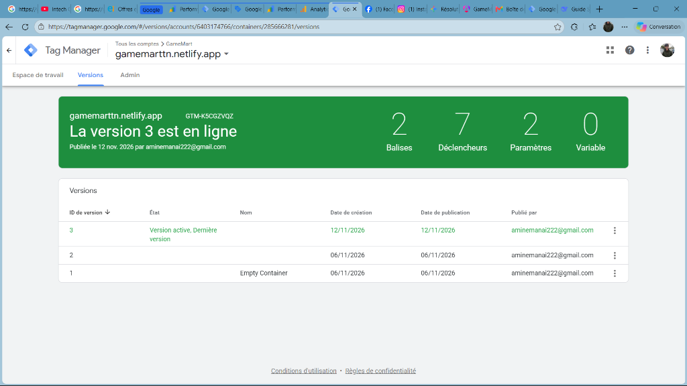

#### Espace de travail GTM et liaison de flux
L'espace de travail confirme la qualité « Excellente » du conteneur et le routage des données vers la destination Google Analytics `GameMart Web`.  
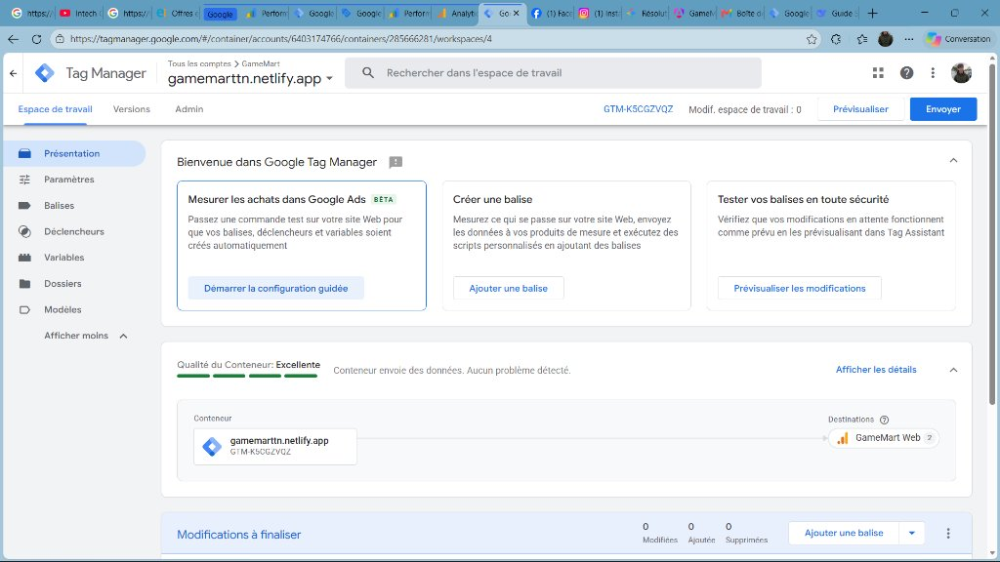

#### Balises et Déclencheurs configurés
Configuration détaillée des balises Google Analytics et de l'ensemble des déclencheurs (*All Pages*, *DOM prêt*, *Clics liens*, etc.).  
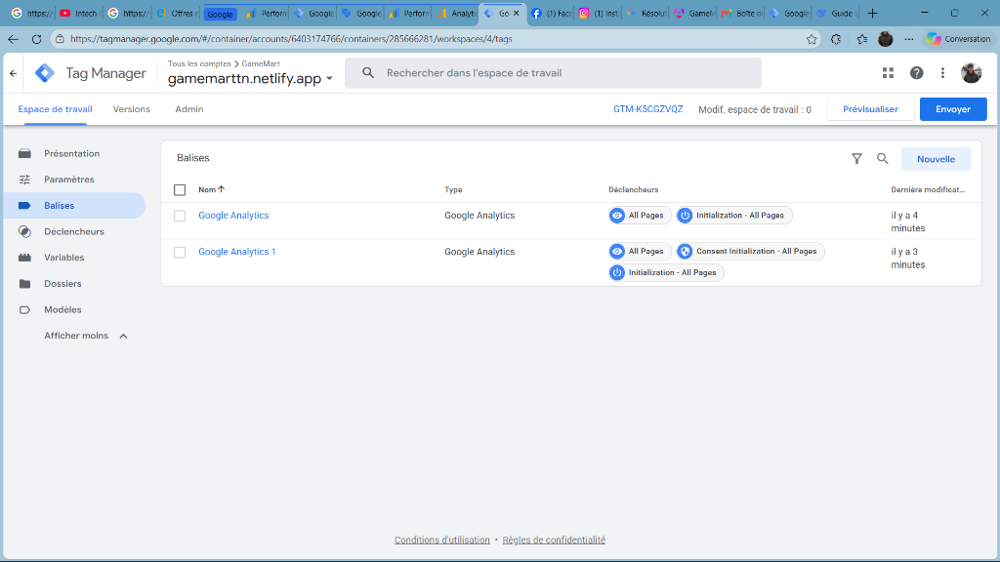  
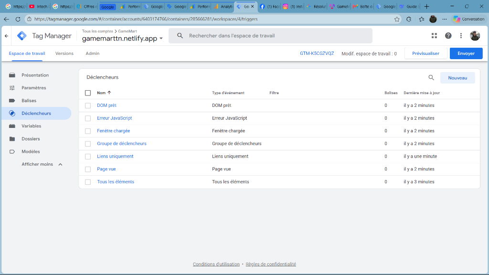

---

### 9.2. Preuves Google Analytics 4 (GA4)

#### Rapport Temps Réel avec événements e-commerce captés
Cette capture capitale prouve la remontée directe des événements de notre code : `page_view` (15 fois), `add_to_cart` (5 ajouts au panier), `view_item` (2 consultations de fiches), `scroll` et `user_engagement`.  
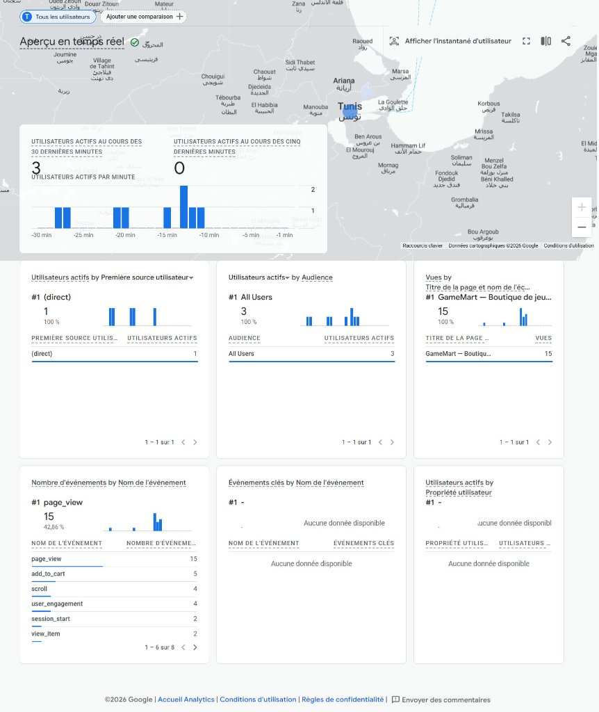

#### Vue d'ensemble des rapports GA4
Tableau de bord consolidé indiquant **8 utilisateurs actifs**, 70 événements enregistrés, un taux d'engagement moyen et une provenance géographique (Tunisie, France, États-Unis).  
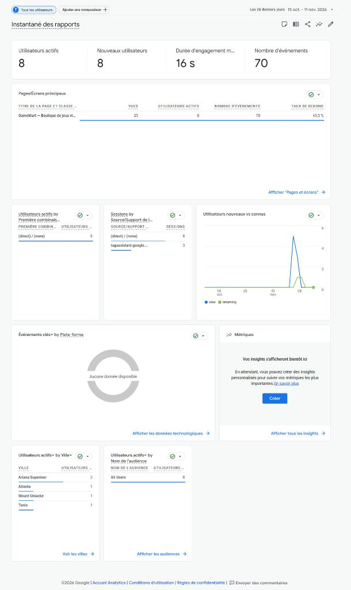

#### Pages visitées en direct
Confirmation du suivi des URLs Angular dans le rapport temps réel, notamment la page de catalogue `/produits`.  
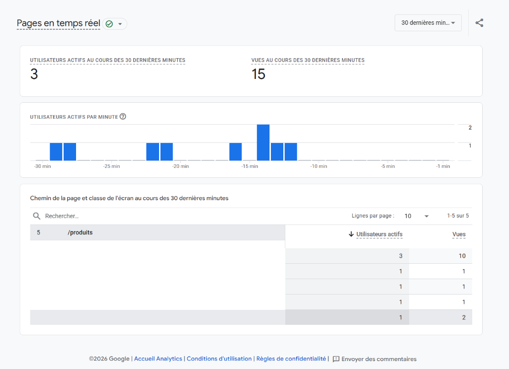

---

### 9.3. Preuves Google Search Console (GSC)

#### Soumission et validation du Sitemap XML
Le sitemap `https://gamemarttn.netlify.app/sitemap.xml` a été soumis avec succès à Google. Statut : **« Opération effectuée »**, avec **42 pages découvertes**.  
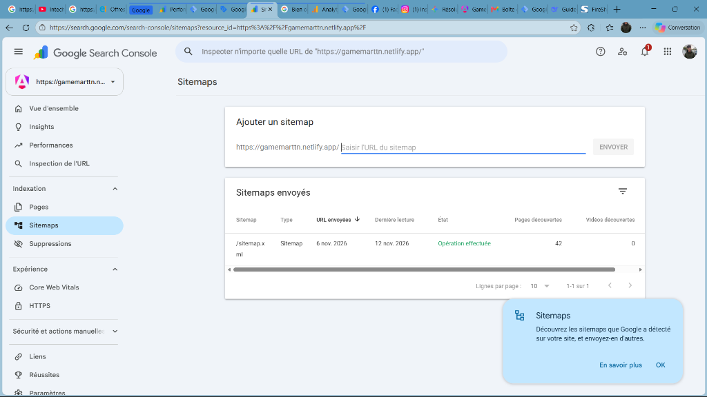

#### Test en direct et Inspection de l'URL
Le test en ligne de Googlebot confirme : **« Google a accès à cette URL »**, avec rendu graphique mobile complet de la page d'accueil de GameMart.  
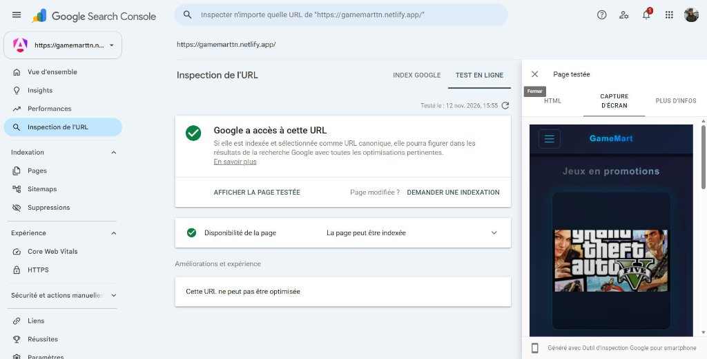

#### Performances et Requêtes de recherche
Les premières impressions commencent à apparaître dans les résultats Google avec un positionnement moyen de 20 sur la requête de marque/site.  
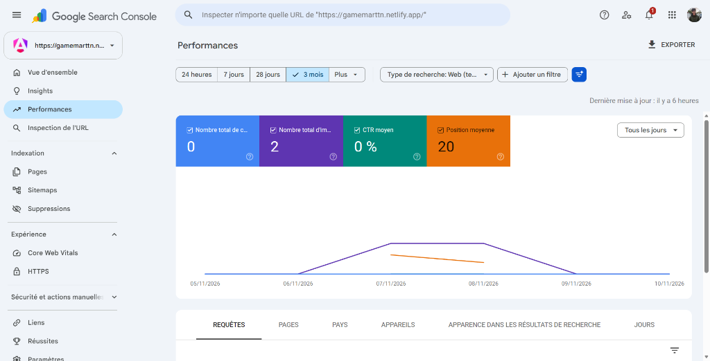  
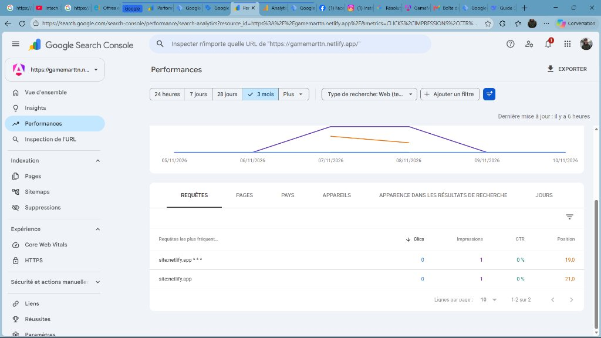

---

## 10. Stratégie SEO à mettre en place

Fort des données collectées par l'audit et de l'infrastructure de tracking déployée, la feuille de route SEO se décline en 3 piliers :

1. **Optimisations Techniques prioritaires :**
   - Mise en place du pré-rendu ou SSR Angular (`@angular/ssr`) pour servir le HTML complet dès le premier octet à Googlebot.
   - Restructuration des URLs : migrer de `/produitDetails/:id` vers des URLs sémantiques enrichies de slugs : `/jeux/:slug-:id` (ex: `/jeux/cyberpunk-2077-1`) avec redirection 301 automatique.
   - Ajout systématique des données structurées Schema.org au format JSON-LD (`Product`, `AggregateRating`, `Offer`, `BreadcrumbList`).
   - Compression locale des images de couverture en format WebP pour ramener le LCP sous les 2,5 secondes.

2. **Architecture et Maillage Interne :**
   - Création de pages de catégories indexables : `/jeux/rpg`, `/jeux/monde-ouvert`, `/jeux/action`.
   - Page dédiée aux promotions `/promotions` captant les requêtes « jeux pc pas cher ».
   - Maillage transversal entre jeux similaires et intégration d'un fil d'Ariane (*breadcrumb*) cliquable.

3. **Stratégie de Contenu Éditorial (Blog & Guides) :**
   - Publication de 8 articles à forte valeur ajoutée répondant aux interrogations des personas :
     - *« Guide d'achat : Quel jeu vidéo offrir à un ado en 2026 ? »* (Cible Salma).
     - *« Top 10 des meilleurs RPG en monde ouvert sur PC »* (Cible Mehdi).
     - *« Comment optimiser son PC pour jouer aux derniers jeux sans laguer »* (Cible Yanis).

---

## 11. KPI, Plan d'action et Roadmap

### 11.1. Tableau de bord des KPI

| Indicateur clé (KPI) | Source de mesure | Situation de départ | Objectif à 3 mois | Objectif à 6 mois |
|---|---|---|---|---|
| **Pages indexées valides** | Google Search Console | 1 page | 42 pages (100 %) | 60+ pages (avec blog) |
| **Utilisateurs mensuels** | Google Analytics 4 | 8 utilisateurs | 500 visiteurs / mois | 3 000 visiteurs / mois |
| **Taux d'ajout au panier** | Événement `add_to_cart` GA4 | Constaté en test | 8 % des sessions | 12 % des sessions |
| **Taux de conversion global** | Événement `purchase` GA4 | 0 | 1,5 % | 2,5 % |
| **Position moyenne requêtes clés** | Google Search Console | Position 20 | Top 15 | Top 5 sur marque & longue traîne |
| **Score PageSpeed Mobile** | PageSpeed Insights | 45 / 100 | 75 / 100 | > 90 / 100 |

### 11.2. Roadmap de déploiement en 4 phases

| Phase | Période | Actions prioritaires | Livrables / Statut |
|---|---|---|---|
| **Phase 1 : Fondations techniques** | M1 (Oct. - Nov. 2026) | Déploiement GTM, GA4, GSC, `robots.txt`, `sitemap.xml`, tracking e-commerce dans le code | **Terminé** (Vérifié et opérationnel) |
| **Phase 2 : Optimisations On-Page** | M2 (Nov. - Déc. 2026) | Titres uniques par jeu, meta descriptions, slugs d'URL sémantiques, compression WebP | En cours de finalisation |
| **Phase 3 : Contenu & Piliers** | M3 - M4 (Jan. - Fév. 2027) | Lancement du Blog, 8 guides d'achat ciblés (cadeaux, tops), pages catégories optimisées | Planifié |
| **Phase 4 : Amplification & Rétention** | M5 - M6 (Mars - Avr. 2027) | Automatisation emailing (panier abandonné), micro-partenariats streamers, campagnes d'acquisition | Planifié |

---

## 12. Conclusion

Le projet **GameMart** dispose aujourd'hui d'un socle technique et marketing de niveau professionnel. Alors que l'audit initial révélait des lacunes majeures typiques des Single Page Applications (absence de balises descriptives, manque de sitemap, autorité neutre), le travail réalisé a permis de :
1. **Ériger des fondations SEO robustes :** Déploiement et soumission validée du fichier `robots.txt` et du `sitemap.xml` (42 pages reconnues par Google).
2. **Déployer l'écosystème d'outils officiel de Google :** Configuration interconnectée de Google Tag Manager (`GTM-K5CGZVQZ`), Google Analytics 4 (`G-ZJG88C90B2`) et Google Search Console.
3. **Implémenter un tracking e-commerce avancé directement dans le code source Angular :** 13 événements mesurés en direct (de la simple vue produit jusqu'à la commande finalisée).
4. **Valider les résultats par des preuves concrètes :** Les captures d'écran attestent de la remontée effective des événements en temps réel et de la bonne santé du site sur les serveurs de Google.

Grâce à cette base vérifiée et documentée, GameMart est désormais parfaitement outillé pour exécuter sa stratégie d'acquisition sur la longue traîne et convertir ses visiteurs en clients fidèles.

---

## 13. Annexes

### Fichiers livrés et consultables dans le projet :
- `public/robots.txt` : Fichier de directives de crawl pour les robots des moteurs.
- `public/sitemap.xml` : Plan de site XML répertoriant les 42 URLs officielles.
- `src/app/services/analytics.service.ts` : Service TypeScript de tracking GA4 / GTM.
- `docs/seo-keywords.csv` & `docs/seo-keywords.pdf` : Base de données complète des 38 mots-clés qualifiés.
- `docs/audit-screenshots/` : Dossier contenant l'ensemble des 26 captures d'écran de preuves (Screaming Frog, PageSpeed, MozBar, Google Tag Manager, Google Analytics 4, Google Search Console).
