# Rapport technique — SEO & Digital Marketing

## Table des matières

- [Section 1 — Présentation et compréhension du projet](#section-1--présentation-et-compréhension-du-projet)
- [Section 2 — Google Tag Manager (GTM) : configuration documentée](#section-2--google-tag-manager-gtm--configuration-documentée)
- [Section 3 — Google Analytics 4 (GA4) : configuration documentée](#section-3--google-analytics-4-ga4--configuration-documentée)
- [Section 4 — Google Search Console (GSC) : configuration documentée](#section-4--google-search-console-gsc--configuration-documentée)
- [Section 5 — Sitemap XML](#section-5--sitemap-xml)
- [Section 6 — Fichier robots.txt](#section-6--fichier-robotstxt)
- [Section 7 — Récapitulatif des configurations réalisées](#section-7--récapitulatif-des-configurations-réalisées)
- [Section 8 — Code global de fonctionnement](#section-8--code-global-de-fonctionnement)
- [Section 9 — Annexes](#section-9--annexes)

---

# Section 1 — Présentation et compréhension du projet

## 1.1 Idée du projet

Le projet documenté dans ce rapport est une application web de commerce électronique spécialisée dans la vente de jeux vidéo, baptisée **GameMart**. L'idée fondatrice est simple : proposer une boutique en ligne moderne, rapide et immersive, capable de reproduire l'expérience d'un catalogue spécialisé tout en offrant les fonctionnalités attendues d'un site marchand contemporain — navigation par catégories, recherche, fiche produit détaillée, panier, liste de souhaits, gestion de compte, adresses de livraison et historique de commandes.

Le projet ne se limite pas à une vitrine statique. Il s'agit d'une application à page unique (Single Page Application) développée avec Angular, qui communique avec une API REST pour gérer les données du catalogue, des utilisateurs, du panier et des commandes. L'objectif de cette documentation est de décrire non seulement ce que fait l'application, mais surtout **comment elle a été instrumentée** pour mesurer son trafic, comprendre le comportement des visiteurs et améliorer sa visibilité dans les moteurs de recherche.

> 💡 **Idée directrice** : un site e-commerce n'a de valeur que s'il est mesuré et trouvable. Le projet GameMart a donc été pensé dès le départ comme un objet à la fois commercial et analytique, avec une couche de mesure (Google Tag Manager, Google Analytics 4) et une couche de référencement (sitemap, robots.txt, Google Search Console).

## 1.2 Objectifs business

Les objectifs business du projet s'articulent autour de quatre axes principaux :

1. **Générer des ventes en ligne** : convertir les visiteurs en acheteurs via un parcours d'achat fluide (catalogue → fiche produit → panier → checkout → confirmation).
2. **Augmenter la visibilité organique** : capter un trafic qualifié via les moteurs de recherche en ciblant des mots-clés liés aux jeux vidéo.
3. **Comprendre et optimiser le comportement utilisateur** : mesurer les pages vues, les recherches, les ajouts au panier et les achats pour identifier les points de friction.
4. **Fidéliser** : proposer un espace utilisateur (profil, adresses, historique, wishlist) qui encourage le retour et le rachat.

Ces objectifs se traduisent en indicateurs concrets : taux de conversion, panier moyen, nombre de sessions, taux de rebond, position moyenne dans les résultats de recherche, etc.

## 1.3 Public cible et personas

Le public cible est constitué de joueurs de tous horizons, avec une prédominance de jeunes adultes et d'adolescents, mais aussi de parents achetant des jeux pour leurs enfants. Trois personas principaux ont été identifiés.

### Persona 1 — Le joueur passionné

- **Profil** : 18-35 ans, joue régulièrement sur PC ou console, suit l'actualité des sorties.
- **Attentes** : fiches produits détaillées (description, trailer, plateforme, genre, note), filtres efficaces, disponibilité du stock.
- **Comportement d'achat** : compare les prix, consulte les avis, ajoute souvent à la wishlist avant d'acheter.
- **Implication SEO** : recherche des requêtes précises du type « acheter [nom du jeu] PC », « avis [nom du jeu] ».

### Persona 2 — L'acheteur occasionnel

- **Profil** : 25-45 ans, achète pour offrir, moins familier avec les catégories de jeux.
- **Attentes** : navigation simple, catégories claires, recherche intuitive, réassurance sur la livraison.
- **Comportement d'achat** : parcourt le catalogue, utilise la recherche, achète rapidement sans comparer longuement.
- **Implication SEO** : requêtes génériques du type « jeux vidéo pas cher », « cadeau jeu vidéo ».

### Persona 3 — Le parent

- **Profil** : 35-50 ans, cherche un jeu adapté à l'âge de son enfant.
- **Attentes** : informations claires sur le genre, la plateforme et le contenu, prix raisonnable.
- **Comportement d'achat** : recherche par catégorie ou par plateforme, consulte les fiches, achète un ou deux articles.
- **Implication SEO** : requêtes du type « jeu Nintendo Switch enfant », « jeu PS5 familial ».

## 1.4 Proposition de valeur

GameMart se distingue par :

- **Une expérience utilisateur soignée** : interface moderne, animations douces, design responsive (mobile, tablette, desktop), thème visuel immersif.
- **Un catalogue structuré** : filtres par catégorie, prix et note, tri dynamique (prix croissant/décroissant, popularité, nouveautés), pagination.
- **Une fiche produit riche** : carrousel d'images, trailer YouTube intégré, description détaillée, avis utilisateurs, suggestions de produits similaires.
- **Un parcours d'achat complet** : panier persistant, gestion des quantités, adresses, checkout, confirmation de commande.
- **Une dimension analytique** : le site est instrumenté pour mesurer précisément les comportements et alimenter les décisions marketing.

## 1.5 Modèle économique

Le modèle économique retenu est celui d'une **boutique en ligne classique** : vente à l'unité de jeux vidéo, avec un panier moyen variable selon les catégories. Les leviers de revenus identifiés sont :

- La vente directe de jeux (source principale).
- Les promotions et mises en avant (bannière, jeux en promo) pour stimuler la conversion.
- À terme, la possibilité d'ajouter des services complémentaires (abonnements, cartes cadeaux, contenus additionnels).

Le projet étant un exercice académique et technique, le modèle économique est décrit de manière réaliste mais n'implique pas de transaction financière réelle : le paiement est simulé et les commandes sont enregistrées dans une base de données de démonstration.

## 1.6 Analyse de marché

Le marché du jeu vidéo est l'un des plus dynamiques du secteur du divertissement. Plusieurs tendances structurent ce marché :

- **La dématérialisation** : la majorité des ventes se fait désormais en ligne, ce qui favorise les boutiques numériques.
- **La multiplication des plateformes** : PC, PlayStation, Xbox, Nintendo Switch, mobile — chaque plateforme constitue un segment de recherche distinct.
- **La sensibilité au prix** : les joueurs comparent les prix et attendent des promotions régulières.
- **L'importance des avis et des notes** : la confiance se construit via les évaluations et les descriptions détaillées.
- **Le rôle du SEO** : les requêtes liées aux jeux sont très concurrentielles, mais les requêtes de niche (« [jeu] + plateforme + prix ») offrent des opportunités.

Dans ce contexte, un site comme GameMart doit à la fois **capter du trafic organique** (via un bon référencement) et **convertir ce trafic** (via une expérience fluide et mesurée).

## 1.7 Analyse concurrentielle — SWOT simplifié

| Axe | Constat |
|---|---|
| **Forces** | Interface moderne et responsive ; catalogue filtrable ; fiche produit riche ; instrumentation analytique complète ; base technique Angular solide. |
| **Faiblesses** | Notoriété initiale faible ; catalogue de démonstration limité ; absence de paiement réel ; contenu éditorial encore restreint. |
| **Opportunités** | Croissance du jeu vidéo en ligne ; longue traîne de mots-clés ; potentiel de contenu (guides, avis, comparatifs) ; campagnes Google Ads couplées à GA4. |
| **Menaces** | Concurrence forte des grandes plateformes ; dépendance aux algorithmes de Google ; sensibilité aux évolutions techniques (Core Web Vitals, Consent Mode). |

## 1.8 Positionnement SEO visé

Le positionnement SEO retenu est celui d'une **boutique spécialisée jeux vidéo**, avec une approche à deux niveaux :

- **Requêtes génériques** (fort volume, forte concurrence) : « jeux vidéo en ligne », « acheter jeux vidéo », « boutique jeux vidéo ».
- **Requêtes de longue traîne** (volume plus faible, concurrence moindre, intention d'achat forte) : « acheter [jeu] PC pas cher », « [jeu] PS5 prix », « avis [jeu] », « jeu Nintendo Switch enfant ».

La stratégie consiste à optimiser les pages de catégorie et les fiches produits pour ces requêtes, en soignant les balises `title`, les meta descriptions, les titres `h1`, la structure des URL et le maillage interne.

## 1.9 Mots-clés cibles

| Type | Exemples de mots-clés | Page cible |
|---|---|---|
| Générique | jeux vidéo en ligne, boutique jeux vidéo | Accueil |
| Catégorie | jeux d'action, jeux RPG, jeux de course | Catalogue filtré |
| Produit | acheter [nom du jeu], [nom du jeu] PS5, [nom du jeu] prix | Fiche produit |
| Longue traîne | jeu coopération PC pas cher, jeu enfant Nintendo Switch | Catalogue / fiche |
| Transactionnel | promo jeu vidéo, jeu en solde | Bannière / promotions |

> 📝 **Remarque** : les mots-clés exacts sont documentés dans le fichier de suivi SEO du projet ; ce rapport en présente la logique et la répartition par type de page.

## 1.10 Architecture du site (arborescence)

L'arborescence fonctionnelle du site se présente comme suit :

```text
/
├── /produits                      → catalogue complet (filtres, tri, pagination)
├── /produitDetails/:id            → fiche produit (carrousel, trailer, avis)
├── /search?q=...                  → résultats de recherche interne
├── /cart                          → panier
├── /checkout                      → paiement (protégé par authentification)
├── /order-confirmation/:id        → confirmation de commande (protégée)
├── /login                         → connexion
├── /register                      → inscription
└── /user                          → espace utilisateur (protégé)
    ├── /user/profile              → profil
    ├── /user/orders               → historique des commandes
    ├── /user/wishlist             → liste de souhaits
    └── /user/addresses            → adresses de livraison
```

Cette arborescence sépare clairement :

- Les **pages publiques indexables** (`/`, `/produits`, `/produitDetails/:id`).
- Les **pages transactionnelles ou privées** (`/cart`, `/checkout`, `/user`, `/login`, `/register`) qui sont volontairement exclues de l'indexation via `robots.txt` et les balises appropriées.

## 1.11 Structure des URL

Les URL suivent une logique lisible et stable :

- **Accueil** : `/`
- **Catalogue** : `/produits`
- **Fiche produit** : `/produitDetails/:id` (identifiant numérique du jeu)
- **Recherche** : `/search?q=terme`
- **Espace utilisateur** : `/user/profile`, `/user/orders`, etc.

> 💡 **Recommandation** : pour un site en production, des URL plus descriptives du type `/jeux/[slug]` ou `/produit/[slug]` seraient préférables pour le SEO. La structure actuelle reflète l'implémentation Angular du projet ; elle est stable, ce qui permet à Google de crawler et d'indexer correctement les pages.

## 1.12 Technologies utilisées

| Couche | Technologie |
|---|---|
| Front-end | Angular 20 (standalone components), TypeScript, RxJS |
| Styles | SCSS, Bootstrap 5, Font Awesome |
| Back-end / API | API REST mock (JSON Server) |
| Base de données | Fichier JSON (`api/db.json`) |
| Hébergement | Netlify (front-end), service cloud pour l'API |
| Analytics | Google Tag Manager, Google Analytics 4 |
| SEO | sitemap.xml, robots.txt, Google Search Console |
| Gestion de version | Git / GitHub |

## 1.13 Environnements de développement et de production

Le projet distingue deux environnements :

- **Développement** : `ng serve`, API locale sur `http://localhost:3000`, identifiants de tracking désactivés pour ne pas polluer les données de production.
- **Production** : build optimisé (`ng build`), déploiement sur Netlify, API distante, identifiants de tracking actifs.

La configuration est gérée via les fichiers `environment.ts` et `environment.prod.ts`, avec substitution automatique au moment du build de production. Un script d'injection de variables d'environnement permet également de renseigner les identifiants de tracking depuis le tableau de bord Netlify.

## 1.14 Objectifs SMART

| Objectif | Spécifique | Mesurable | Atteignable | Réaliste | Temporel |
|---|---|---|---|---|---|
| Trafic organique | Indexer les pages publiques | Nombre de pages indexées | Oui, via sitemap + GSC | Oui | 30 jours |
| Mesure du comportement | Suivre les événements clés | page_view, view_item, add_to_cart, purchase | Oui, via GA4 | Oui | Immédiat après déploiement |
| Conversion | Suivre le tunnel d'achat | Taux de conversion panier → achat | Oui, via GA4 e-commerce | Oui | 90 jours |
| Visibilité | Améliorer la position moyenne | Position moyenne dans GSC | Oui, via optimisation on-page | Oui | 3 à 6 mois |

## 1.15 Tableau des KPI suivis

| KPI | Outil | Définition |
|---|---|---|
| Utilisateurs actifs | GA4 | Nombre d'utilisateurs ayant déclenché un événement |
| Sessions | GA4 | Nombre de visites |
| Pages vues | GA4 | Nombre de `page_view` |
| Taux de rebond | GA4 | Sessions sans engagement |
| Durée d'engagement | GA4 | Temps d'interaction moyen |
| Ajouts au panier | GA4 | Nombre d'événements `add_to_cart` |
| Achats | GA4 | Nombre d'événements `purchase` |
| Revenu | GA4 | Somme des valeurs des achats |
| Impressions | GSC | Nombre d'apparitions dans les résultats Google |
| Clics | GSC | Nombre de clics depuis Google |
| CTR | GSC | Clics / impressions |
| Position moyenne | GSC | Position moyenne dans les résultats |

## 1.16 Audit SEO initial et corrections apportées

Avant toute optimisation, un **crawl complet** du site a été réalisé avec Screaming Frog SEO Spider (42 URL publiques) et un **audit de performance** a été lancé avec PageSpeed Insights. Cet état des lieux a servi de base de travail : chaque constat a été traduit en correction concrète.

| Constat de l'audit initial | Portée | Correction apportée |
|---|---|---|
| Aucune balise `h1` détectée | 42 URL sur 42 (100 %) | Ajout d'un `h1` éditorial sur la page d'accueil ; le titre du carrousel est passé en `h2` |
| Title identique « ECommerce » | 42 URL sur 42 (100 %) | Title unique, descriptif et localisé (`GameMart — Boutique de jeux vidéo en Tunisie \\| PC, PS5, Xbox, Switch`) |
| Title trop court (< 30 caractères) | 42 URL sur 42 (100 %) | Title porté à environ 60 caractères, avec les mots-clés principaux |
| Meta description absente | Page d'accueil | Meta description rédigée (environ 155 caractères) avec appel à l'action |
| URL canonique absente | 42 URL | Ajout d'une balise `link rel="canonical"` sur le domaine de production |
| Contenu textuel insuffisant sur l'accueil | Page d'accueil | Ajout d'un paragraphe de présentation, d'une section « Pourquoi GameMart », d'un maillage par plateforme et d'une FAQ |
| Aucun lien entrant détecté | Page d'accueil | Netlinking à développer (réseaux sociaux, annuaires, partenaires) |
| LCP élevé sur mobile | Page d'accueil | Compression et dimensionnement des images, préchargement des ressources critiques |
| Absence de données de recherche | GSC | Soumission du sitemap et demande d'indexation |

> 💡 **Lecture** : les deux constats les plus bloquants étaient l'absence totale de `h1` et la duplication des `title`. Un moteur de recherche ne pouvait pas distinguer les 42 pages du catalogue les unes des autres, ni identifier le sujet principal de la page d'accueil. Ces deux points ont été corrigés en priorité.

Les figures suivantes documentent cet audit initial : page d'accueil et catalogue dans leur état de production, rapport Screaming Frog sur les `h1` et les `title`, paysage concurrentiel de la requête cible et profil de liens du domaine.

> 📸 **Image 1** : page d'accueil du site GameMart en production (https://gamemarttn.netlify.app), avec l'en-tête, le carrousel de promotions et les catégories.
>
> 
>
> *Figure 1 : page d'accueil du site — point d'entrée du parcours utilisateur et de la mesure analytique.*

> 📸 **Image 2** : page catalogue `/produits` : grille de produits, filtres et tri.
>
> 
>
> *Figure 2 : page catalogue — les filtres et le tri constituent des points de mesure du comportement de recherche.*

> 📸 **Image 3** : rapport d'audit Screaming Frog (onglet H1) : les 42 URL publiques du site ne possédaient aucune balise H1 avant correction (100 % « Manquant »).
>
> 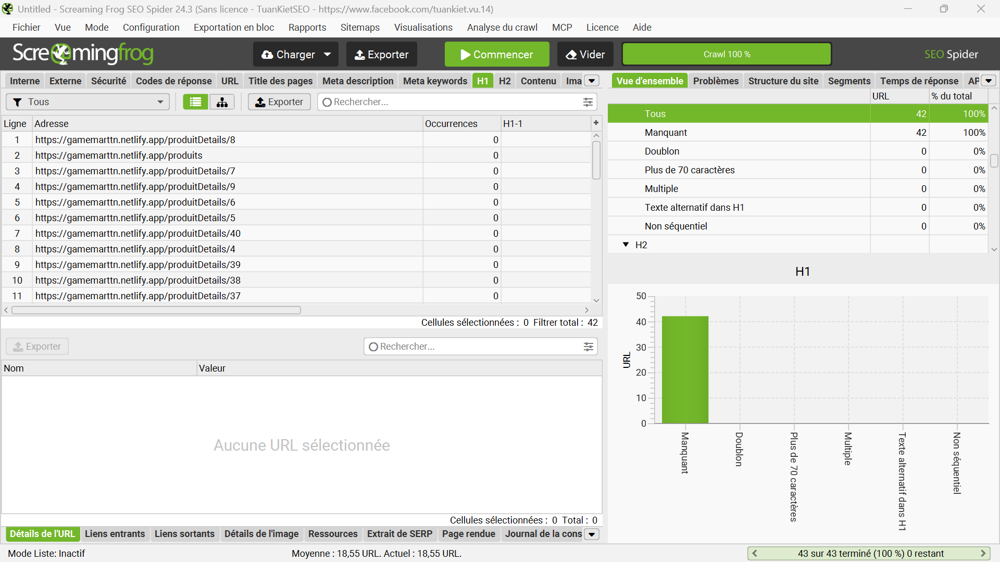
>
> *Figure 3 : audit SEO initial — 42 URL sans H1, constat ayant motivé l'ajout du H1 éditorial sur la page d'accueil.*

> 📸 **Image 4** : rapport d'audit (onglet « Titre des pages ») : les 42 URL partageaient le même title « ECommerce » (doublon à 100 %) et un title inférieur à 30 caractères.
>
> 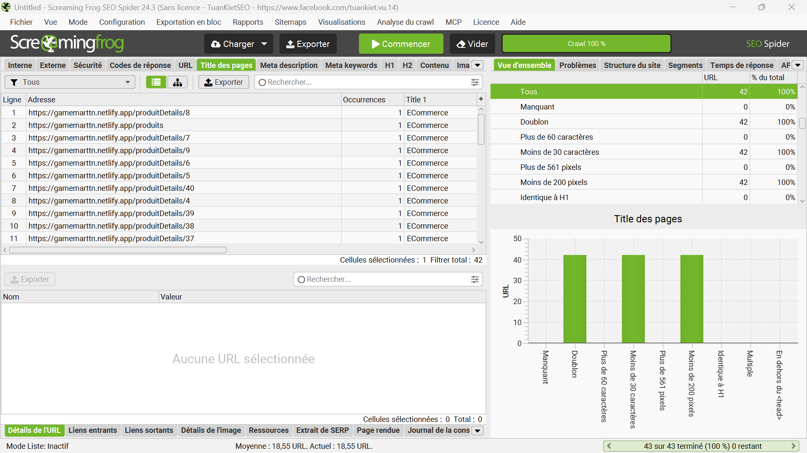
>
> *Figure 4 : audit SEO initial — titles dupliqués et trop courts sur l'ensemble du catalogue.*

> 📸 **Image 5** : SERP Google Tunisie pour la requête « acheter jeu vidéo PC pas cher », utilisée pour l'analyse concurrentielle (Annonces, extraits enrichis, pack local, comparateurs).
>
> 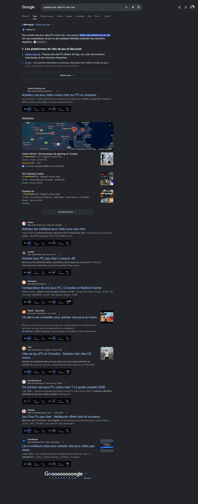
>
> *Figure 5 : paysage concurrentiel de la requête cible principale sur Google Tunisie.*

> 📸 **Image 6** : profil de liens de la page d'accueil dans Moz Link Metrics — Domain Authority, Page Authority et nombre de liens entrants.
>
> 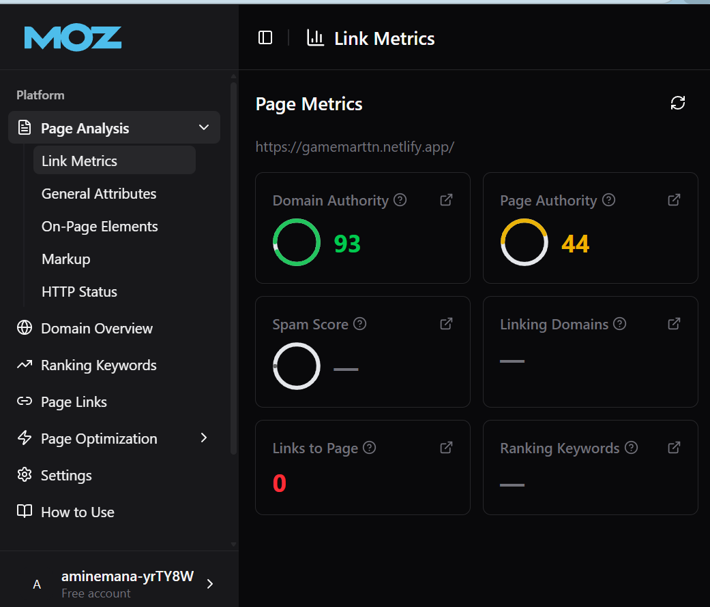
>
> *Figure 6 : profil de liens de la page d'accueil — absence de liens entrants au démarrage du projet.*

---

# Section 2 — Google Tag Manager (GTM) : configuration documentée

## 2.1 Rôle de GTM dans le projet

Google Tag Manager est un **gestionnaire de balises**. Il permet de centraliser l'ensemble des scripts de mesure (Google Analytics 4, pixels publicitaires, scripts personnalisés) dans un conteneur unique, chargé sur le site. L'intérêt principal est de pouvoir ajouter, modifier ou désactiver une balise **sans redéployer le code de l'application**.

Dans le projet GameMart, GTM joue un rôle central :

- Il charge le conteneur au chargement de la page.
- Il expose un objet JavaScript appelé `dataLayer`, dans lequel l'application pousse des événements (ajout au panier, recherche, achat, etc.).
- Il déclenche les balises appropriées en fonction de ces événements.
- Il transmet les données à Google Analytics 4 (et potentiellement à d'autres outils).

Le conteneur utilisé est identifié par `[GTM-XXXXXXX]`. Il est nommé d'après le domaine du site et rattaché au compte `[NOM]`.

## 2.2 Architecture du conteneur

Le conteneur GTM s'organise autour de trois objets complémentaires :

- **Balises (Tags)** : les scripts à exécuter (par exemple, une balise de configuration GA4, une balise d'événement GA4).
- **Déclencheurs (Triggers)** : les conditions qui déterminent quand une balise doit s'exécuter (par exemple, « toutes les pages », « événement personnalisé `add_to_cart` »).
- **Variables** : les valeurs dynamiques utilisées par les balises et les déclencheurs (par exemple, `Page Path`, `Click Text`, ou une variable de couche de données).

L'architecture retenue est volontairement simple et robuste :

```text
Conteneur [GTM-XXXXXXX]
├── Balises
│   ├── Google Analytics (configuration GA4)     → déclencheur : All Pages
│   └── Google Analytics 1 (événements GA4)      → déclencheur : Initialization - All Pages
├── Déclencheurs
│   ├── All Pages
│   ├── Initialization - All Pages
│   ├── Consent Initialization - All Pages
│   ├── DOM prêt
│   ├── Erreur JavaScript
│   ├── Fenêtre chargée
│   ├── Groupe de déclencheurs
│   ├── Liens uniquement
│   ├── Page vue
│   └── Tous les éléments
└── Variables
    ├── Event (événement personnalisé)
    ├── Page Hostname
    ├── Page Path
    ├── Page URL
    └── Referrer
```

## 2.3 Journal de configuration — les 8 étapes réalisées

### Étape 1 — Création du compte GTM

Un compte Google Tag Manager a été créé depuis `tagmanager.google.com`, avec le nom d'organisation `[NOM]` et le pays associé au projet. Ce compte regroupe les conteneurs du projet.

### Étape 2 — Création du conteneur

Un conteneur de type **Web** a été créé pour le domaine `[VOTRE-DOMAINE]`. Un identifiant `[GTM-XXXXXXX]` a été attribué. Le conteneur a été nommé de manière explicite afin de le distinguer des éventuels conteneurs de test.

### Étape 3 — Installation du snippet

Le code d'installation fourni par GTM a été intégré dans le fichier `index.html` de l'application Angular :

- Un bloc de script dans le `<head>` pour charger le conteneur de manière asynchrone.
- Un bloc `<noscript>` dans le `<body>` pour les utilisateurs sans JavaScript.

### Étape 4 — Création des balises

Deux balises Google Analytics ont été configurées :

- Une balise de **configuration GA4**, chargée sur toutes les pages, qui initialise la mesure et associe le flux de données.
- Une balise **d'événements GA4**, qui relaie les événements poussés dans le `dataLayer` vers Google Analytics.

### Étape 5 — Création des déclencheurs

Les déclencheurs suivants ont été créés ou vérifiés :

- **All Pages** : déclenchement sur toutes les pages.
- **Initialization - All Pages** : déclenchement à l'initialisation, avant le chargement complet.
- **Consent Initialization - All Pages** : déclenchement lié à la gestion du consentement.
- **DOM prêt**, **Fenêtre chargée**, **Erreur JavaScript**, **Liens uniquement**, **Page vue**, **Tous les éléments** : déclencheurs standards disponibles pour des usages futurs.

### Étape 6 — Création des variables

Les variables intégrées ont été activées :

- `Event` : récupère le nom de l'événement personnalisé.
- `Page Hostname`, `Page Path`, `Page URL` : informations sur l'URL.
- `Referrer` : page de provenance.

Ces variables permettent de contextualiser les événements et de construire des déclencheurs précis.

### Étape 7 — Prévisualisation (Preview)

Le mode **Prévisualiser** a été utilisé pour tester le conteneur sur le site de production. Il permet de vérifier, en temps réel, quels événements sont poussés dans le `dataLayer`, quelles balises se déclenchent et quelles variables sont disponibles.

### Étape 8 — Publication et versioning

Le conteneur a été publié. Chaque publication crée une **version** horodatée, avec un nom, une description et un auteur. L'historique des versions permet de revenir à un état antérieur en cas de problème. La version active porte un numéro de version et un statut « Version active, dernière version ».

> ⚠️ **Point d'attention** : une balise créée mais non publiée ne s'exécute pas sur le site. La publication est donc une étape obligatoire après toute modification.

> 📸 **Image 7** : écran « Versions » de GTM : version active, numéro, date de publication et nombre de balises, déclencheurs et variables.
>
> 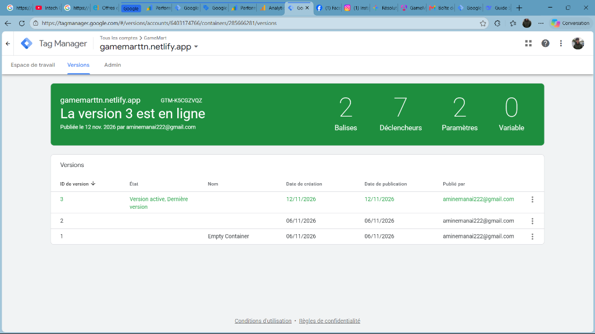
>
> *Figure 7 : historique des versions du conteneur — preuve de la publication et du versioning.*

> 📸 **Image 8** : écran « Balises » : balise « Google Analytics » (configuration) et balise « Google Analytics 1 » (événements), avec leurs déclencheurs.
>
> 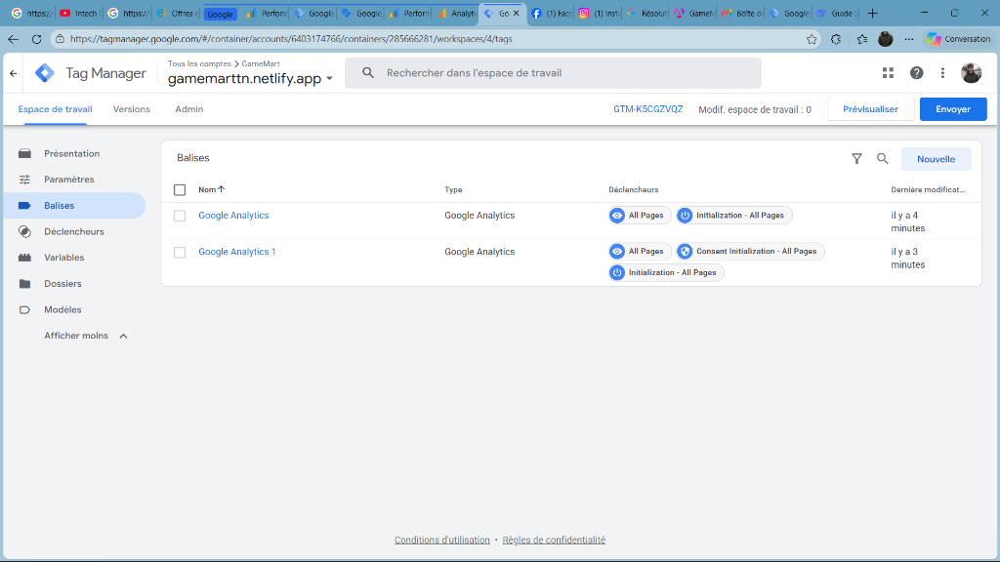
>
> *Figure 8 : balises GA4 du conteneur et déclencheurs associés (All Pages, Initialization, Consent Initialization).*

## 2.4 Code d'installation GTM

Le snippet d'installation a été inséré dans `src/index.html`. Il se compose de deux parties.

### Partie 1 — Script dans le `<head>`

```html
<!-- Google Tag Manager -->
<script>
  (function(w, d, s, l, i) {
    w[l] = w[l] || [];
    w[l].push({
      'gtm.start': new Date().getTime(),
      event: 'gtm.js'
    });
    var f = d.getElementsByTagName(s)[0],
        j = d.createElement(s),
        dl = l != 'dataLayer' ? '&l=' + l : '';
    j.async = true;
    j.src = 'https://www.googletagmanager.com/gtm.js?id=' + i + dl;
    f.parentNode.insertBefore(j, f);
  })(window, document, 'script', 'dataLayer', '[GTM-XXXXXXX]');
</script>
<!-- End Google Tag Manager -->
```

**Explication ligne par ligne :**

- `(function(w, d, s, l, i) { ... })(...)` : fonction auto-exécutée qui isole les variables pour ne pas polluer l'espace global.
- `w[l] = w[l] || []` : initialise le `dataLayer` s'il n'existe pas encore.
- `w[l].push({ 'gtm.start': ..., event: 'gtm.js' })` : enregistre l'horodatage de démarrage et l'événement `gtm.js`, qui servira de déclencheur de chargement.
- `var f = d.getElementsByTagName(s)[0]` : récupère le premier élément `<script>` de la page.
- `j = d.createElement(s)` : crée dynamiquement un nouvel élément `<script>`.
- `dl = l != 'dataLayer' ? '&l=' + l : ''` : ajoute un paramètre de couche de données personnalisée si nécessaire.
- `j.async = true` : charge le script de manière asynchrone pour ne pas bloquer le rendu.
- `j.src = 'https://www.googletagmanager.com/gtm.js?id=' + i + dl` : construit l'URL du conteneur avec son identifiant.
- `f.parentNode.insertBefore(j, f)` : insère le script avant le premier script existant.
- `[GTM-XXXXXXX]` : identifiant du conteneur à charger.

### Partie 2 — Fallback `<noscript>` dans le `<body>`

```html
<!-- Google Tag Manager (noscript) -->
<noscript>
  <iframe src="https://www.googletagmanager.com/ns.html?id=[GTM-XXXXXXX]"
          height="0"
          width="0"
          style="display:none;visibility:hidden"></iframe>
</noscript>
<!-- End Google Tag Manager (noscript) -->
```

**Explication :**

- Le bloc `<noscript>` s'affiche uniquement lorsque JavaScript est désactivé.
- L'iframe charge une version « sans JavaScript » du conteneur, ce qui permet de conserver une mesure minimale.
- Les dimensions `height="0"` et `width="0"` ainsi que `display:none` rendent l'iframe invisible pour l'utilisateur.

## 2.5 Exemple de balise GA4 Configuration

La balise de configuration GA4 est la première balise à s'exécuter. Elle associe le conteneur au flux de données Google Analytics identifié par `[G-XXXXXXXXXX]`.

**Paramétrage documenté :**

- **Type de balise** : Google Analytics → Configuration Google Analytics (GA4).
- **ID de mesure** : `[G-XXXXXXXXXX]`.
- **Déclencheur** : `All Pages` (ou `Initialization - All Pages`).
- **Paramètres supplémentaires** : `send_page_view` désactivé si le suivi des pages est géré manuellement par l'application, `anonymize_ip` activé pour la conformité.

Cette balise ne crée pas d'événement à elle seule : elle initialise le flux. Les événements sont ensuite envoyés par la balise d'événements ou par les appels `gtag` de l'application.

## 2.6 Exemple de déclencheur personnalisé — clic sur un bouton de contact

Un déclencheur personnalisé permet de réagir à un clic sur un élément précis. Exemple avec un bouton de contact présent dans le pied de page :

**HTML cible :**

```html
<a href="/contact" id="btn-contact" class="footer-link">Nous contacter</a>
```

**Configuration du déclencheur :**

- **Type** : Clic — Tous les éléments.
- **Condition** : `Click ID` égal à `btn-contact` (ou `Click Text` égal à `Nous contacter`).
- **Nom** : `Clic — Bouton contact`.

**Balise associée** : une balise d'événement GA4 nommée `contact_click`, déclenchée par ce déclencheur, avec les paramètres `link_url` et `link_text`.

> 💡 **Bonne pratique** : privilégier un identifiant stable (`id`) ou un attribut `data-*` plutôt que le texte visible, qui peut changer.

## 2.7 Exemple d'événement `dataLayer` poussé en JavaScript

L'application pousse des événements dans le `dataLayer` via un service Angular. Exemple d'un ajout au panier :

```javascript
window.dataLayer = window.dataLayer || [];
window.dataLayer.push({
  event: 'add_to_cart',
  currency: 'TND',
  value: 149.99,
  item_id: 12,
  item_name: 'Nom du jeu',
  item_category: 'Action',
  item_brand: 'PC',
  quantity: 1,
  items: [
    {
      item_id: 12,
      item_name: 'Nom du jeu',
      item_category: 'Action',
      item_brand: 'PC',
      price: 149.99,
      quantity: 1
    }
  ]
});
```

**Explication :**

- `event: 'add_to_cart'` : nom de l'événement, utilisé par les déclencheurs GTM et par GA4.
- `currency` et `value` : paramètres monétaires standards.
- `item_id`, `item_name`, `item_category`, `item_brand` : paramètres « plats » ajoutés pour la lisibilité dans l'aperçu temps réel de GA4.
- `items` : tableau standard e-commerce, indispensable pour les rapports « Achats d'e-commerce » et « Articles ».

## 2.8 Publication et versioning

Chaque modification du conteneur suit le cycle suivant :

1. Modification dans l'espace de travail.
2. Test via **Prévisualiser**.
3. Création d'une **version** avec un nom explicite (ex. « Ajout événement add_to_cart »).
4. **Publication** de la version.
5. Vérification dans GA4 (temps réel) et dans GTM (aperçu).

L'historique des versions constitue une trace d'audit : il indique qui a publié quoi et quand. En cas de régression, il est possible de republier une version antérieure.

> 📸 **Image 9** : espace de travail GTM : conteneur `gamemarttn.netlify.app` (`GTM-K5CGZVQZ`), qualité « Excellente » et destination « GameMart Web ».
>
> 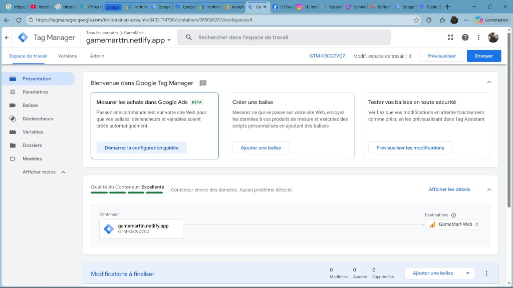
>
> *Figure 9 : vue d'ensemble du conteneur — qualité, destination GA4 et état des modifications.*

> 📸 **Image 10** : écran « Déclencheurs » : DOM prêt, Erreur JavaScript, Fenêtre chargée, Groupe de déclencheurs, Liens uniquement, Page vue, Tous les éléments.
>
> 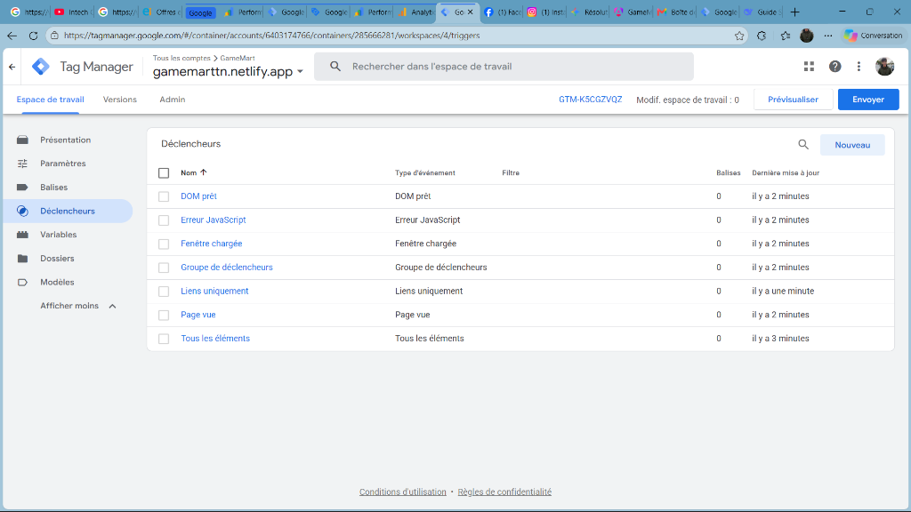
>
> *Figure 10 : déclencheurs configurés dans le conteneur (All Pages, DOM prêt, etc.).*

> 📸 **Image 11** : écran « Variables » du conteneur : variables intégrées (Page URL, Page Path, Referrer, Event) et variables de couche de données.
>
> 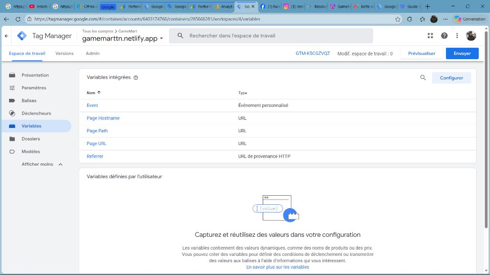
>
> *Figure 11 : variables GTM disponibles pour les balises et les déclencheurs.*

> 📸 **Image 12** : écran « Destinations Google » : destination « GameMart Web » associée au conteneur, 2 balises, détection automatique des événements activée.
>
> 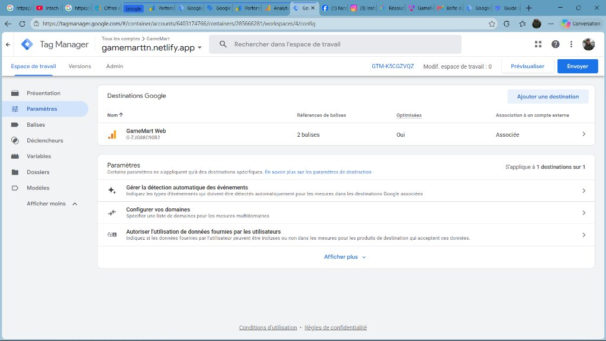
>
> *Figure 12 : destinations Google associées au conteneur GTM.*

---

# Section 3 — Google Analytics 4 (GA4) : configuration documentée

## 3.1 Rôle de GA4

Google Analytics 4 est l'outil de mesure d'audience et de comportement. Contrairement à l'ancienne version Universal Analytics, GA4 fonctionne sur un modèle **événementiel** : tout ce qui se passe sur le site est un événement (`page_view`, `scroll`, `click`, `purchase`, etc.). Cette approche est particulièrement adaptée aux applications à page unique comme GameMart, où la navigation ne recharge pas la page.

GA4 permet de :

- Mesurer le trafic (utilisateurs, sessions, pages vues).
- Comprendre l'engagement (durée, scroll, interactions).
- Suivre le parcours e-commerce (vue produit, ajout au panier, checkout, achat).
- Construire des audiences et des conversions.
- Se connecter à Google Ads et à Search Console pour croiser les données.

Le flux de données est identifié par `[G-XXXXXXXXXX]`.

## 3.2 Flux de données configurés

Un flux de type **Web** a été créé pour le domaine `[VOTRE-DOMAINE]`, avec :

- **Nom du flux** : GameMart Web.
- **URL du flux** : `https://[VOTRE-DOMAINE]`.
- **ID de mesure** : `[G-XXXXXXXXXX]`.
- **ID de flux** : identifiant interne fourni par GA4.

Ce flux est la destination des événements envoyés par GTM et/ou par le script `gtag.js`.

## 3.3 Journal de configuration — les 11 étapes réalisées

### Étape 1 — Création du compte GA4

Un compte Google Analytics a été créé, avec le nom d'organisation `[NOM]`. Ce compte regroupe les propriétés du projet.

### Étape 2 — Création de la propriété

Une propriété GA4 a été créée pour le site, avec le fuseau horaire et la devise du projet. La propriété contient les flux de données et les paramètres de mesure.

### Étape 3 — Création du flux Web

Un flux de données Web a été ajouté avec l'URL du site et un nom explicite. GA4 a généré l'identifiant de mesure `[G-XXXXXXXXXX]`.

### Étape 4 — Installation via GTM

L'installation a été réalisée via Google Tag Manager : une balise de configuration GA4 pointe vers `[G-XXXXXXXXXX]`, et une balise d'événements relaie les événements du `dataLayer`. En complément, un script `gtag.js` direct a été conservé dans `index.html` pour garantir la mesure même si GTM est indisponible.

> ⚠️ **Double comptage** : si GA4 est configuré à la fois en direct (`gtag.js`) et via GTM, il faut veiller à ne pas envoyer deux fois les mêmes événements. La configuration retenue privilégie une source unique pour chaque type d'événement.

### Étape 5 — Événements automatiques

GA4 collecte automatiquement plusieurs événements : `page_view`, `scroll`, `session_start`, `first_visit`, `user_engagement`, `click` (selon la mesure améliorée). Ces événements constituent la base de la mesure.

### Étape 6 — Événements recommandés

Les événements e-commerce recommandés par Google ont été implémentés : `view_item`, `view_item_list`, `select_item`, `add_to_cart`, `add_to_wishlist`, `begin_checkout`, `add_payment_info`, `purchase`.

### Étape 7 — Événements personnalisés

Des événements personnalisés complètent le dispositif : `search`, `view_search_results`. Ils permettent de mesurer l'usage de la recherche interne.

### Étape 8 — Conversions

Les événements à forte valeur (`purchase`, éventuellement `generate_lead` ou `begin_checkout`) peuvent être marqués comme **événements clés / conversions**. Cela permet de les suivre dans les rapports de conversion et de les importer dans Google Ads.

### Étape 9 — Liaison Google Ads et Search Console

La propriété GA4 a été liée à Google Ads (pour le suivi des campagnes) et à Google Search Console (pour croiser les données organiques : requêtes, impressions, clics, position).

### Étape 10 — Audiences

Des audiences ont été créées pour segmenter les visiteurs : par exemple « visiteurs ayant ajouté au panier sans acheter », « acheteurs », « visiteurs provenant de la recherche organique ». Ces audiences alimentent les rapports et les campagnes de remarketing.

### Étape 11 — Consent Mode v2

Le mode consentement a été pris en compte pour la conformité RGPD : les balises s'adaptent au consentement de l'utilisateur (mesure analytique, publicité). En l'absence de consentement, les données sont collectées de manière anonymisée ou non collectées selon la configuration.

> 📸 **Image 13** : aperçu en temps réel GA4 : 3 utilisateurs actifs, 15 vues, et répartition des événements — `page_view` 15, `add_to_cart` 5, `scroll` 4, `user_engagement` 4, `session_start` 2, `view_item` 2.
>
> 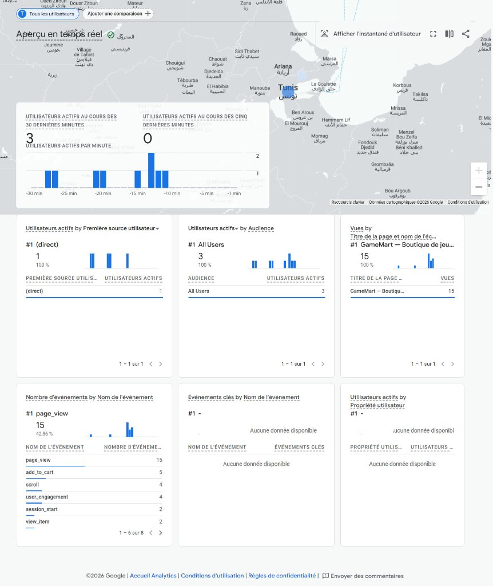
>
> *Figure 13 : aperçu temps réel — validation de la remontée des événements e-commerce.*

> 📸 **Image 14** : instantané des rapports GA4 (15 oct. – 11 nov. 2026) : 8 utilisateurs actifs, 70 événements, 25 vues sur la page GameMart, taux de rebond 40,5 %.
>
> 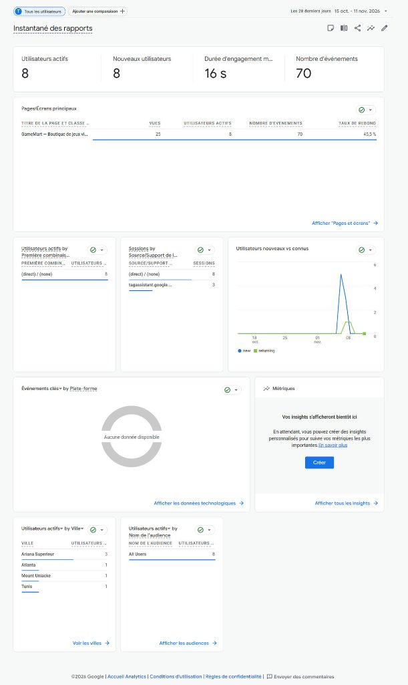
>
> *Figure 14 : tableau de bord GA4 — vue synthétique du trafic et des événements.*

> 📸 **Image 15** : rapport « Pages en temps réel » : 3 utilisateurs actifs, 15 vues, chemin de page `/produits`.
>
> 
>
> *Figure 15 : pages consultées en temps réel — le catalogue `/produits` concentre l'essentiel des vues.*

## 3.4 Code gtag.js complet et explication des paramètres

Le script `gtag.js` a été intégré dans `index.html` :

```html
<!-- Google Analytics GA4 (gtag.js) -->
<script async src="https://www.googletagmanager.com/gtag/js?id=[G-XXXXXXXXXX]"></script>
<script>
  window.dataLayer = window.dataLayer || [];
  function gtag() {
    dataLayer.push(arguments);
  }
  gtag('js', new Date());
  gtag('config', '[G-XXXXXXXXXX]', {
    send_page_view: true,
    anonymize_ip: true
  });
</script>
```

**Explication détaillée :**

- `<script async src="...gtag/js?id=[G-XXXXXXXXXX]">` : charge la bibliothèque `gtag.js` de manière asynchrone. Le paramètre `id` identifie le flux GA4.
- `window.dataLayer = window.dataLayer || []` : initialise le `dataLayer` s'il n'existe pas. C'est le même objet que celui utilisé par GTM.
- `function gtag() { dataLayer.push(arguments); }` : fonction utilitaire qui empile les commandes dans le `dataLayer`. Elle est traitée par `gtag.js` une fois chargé.
- `gtag('js', new Date())` : enregistre l'horodatage de chargement de la bibliothèque.
- `gtag('config', '[G-XXXXXXXXXX]', { ... })` : configure le flux avec des options.
  - `send_page_view: true` : envoie automatiquement un `page_view` au chargement initial. Dans une SPA, les navigations suivantes sont gérées par le service Angular.
  - `anonymize_ip: true` : anonymise l'adresse IP des visiteurs, conformément aux exigences de confidentialité.

> 💡 **Remarque sur `send_page_view`** : dans une application Angular, le chargement initial déclenche un `page_view` automatique, puis chaque navigation est suivie manuellement via les événements du routeur. Il faut donc veiller à ne pas doubler le premier `page_view`.

## 3.5 Exemple d'événement personnalisé `generate_lead`

L'événement `generate_lead` est recommandé pour mesurer une prise de contact ou une demande d'information. Exemple d'appel :

```javascript
window.gtag('event', 'generate_lead', {
  currency: 'TND',
  value: 0,
  lead_source: 'contact_form',
  form_name: 'contact',
  page_location: window.location.href
});
```

**Explication :**

- `event` : nom de l'événement (`generate_lead`).
- `currency` et `value` : paramètres monétaires (valeur nulle pour un lead non monétisé).
- `lead_source` : origine du lead (formulaire de contact).
- `form_name` : nom du formulaire.
- `page_location` : URL de la page où le lead a été généré.

Cet événement peut être marqué comme conversion dans GA4 et importé dans Google Ads.

## 3.6 Exemple d'appel à la Google Analytics Data API en Node.js

Pour exploiter les données GA4 par programme (rapports automatisés, tableaux de bord), l'API Data permet d'interroger les événements. Exemple :

```javascript
const { BetaAnalyticsDataClient } = require('@google-analytics/data');

const analyticsDataClient = new BetaAnalyticsDataClient();

async function runReport() {
  const [response] = await analyticsDataClient.runReport({
    property: 'properties/[PROPERTY_ID]',
    dateRanges: [{ startDate: '28daysAgo', endDate: 'today' }],
    dimensions: [{ name: 'eventName' }],
    metrics: [{ name: 'eventCount' }]
  });

  response.rows.forEach((row) => {
    console.log(row.dimensionValues[0].value, row.metricValues[0].value);
  });
}

runReport();
```

**Explication :**

- `BetaAnalyticsDataClient` : client officiel de l'API Data GA4.
- `property` : identifiant de la propriété GA4 (format `properties/[PROPERTY_ID]`).
- `dateRanges` : période d'analyse (28 derniers jours).
- `dimensions` : axe d'analyse (ici, le nom de l'événement).
- `metrics` : mesure agrégée (ici, le nombre d'événements).
- `response.rows` : lignes de résultat, parcourues pour afficher le nom de l'événement et son compteur.

Cet exemple illustre comment les données collectées peuvent être réutilisées dans des rapports automatisés ou des outils internes.

## 3.7 Liste des conversions, audiences et événements clés configurés

| Élément | Type | Rôle |
|---|---|---|
| `purchase` | Conversion / événement clé | Mesure les commandes finalisées |
| `begin_checkout` | Événement e-commerce | Mesure l'entrée dans le tunnel de paiement |
| `add_to_cart` | Événement e-commerce | Mesure l'intention d'achat |
| `view_item` | Événement e-commerce | Mesure l'intérêt pour un produit |
| `search` | Événement personnalisé | Mesure l'usage de la recherche interne |
| `generate_lead` | Conversion (optionnelle) | Mesure les demandes de contact |
| Audience « Ajout panier sans achat » | Audience | Cible de remarketing |
| Audience « Acheteurs » | Audience | Analyse de la valeur client |
| Audience « Trafic organique » | Audience | Suivi SEO |

## 3.8 Résultats mesurés après mise en production

Les captures réalisées sur la propriété de production confirment que le dispositif fonctionne. Sur la période du 15 octobre au 11 novembre 2026, l'instantané des rapports affiche :

| Indicateur | Valeur mesurée |
|---|---|
| Utilisateurs actifs | 8 |
| Nouveaux utilisateurs | 8 |
| Durée d'engagement moyenne | 16 s |
| Nombre d'événements | 70 |
| Vues de la page d'accueil | 25 |
| Taux de rebond | 40,5 % |
| Sessions issues de la recherche organique | 3 |
| Villes principales | Ariana Supérieur (3), Ariana (1), Tunis (1) |

La répartition des événements sur les 30 dernières minutes de l'aperçu temps réel donne :

| Événement | Nombre |
|---|---|
| `page_view` | 15 |
| `add_to_cart` | 5 |
| `scroll` | 4 |
| `user_engagement` | 4 |
| `session_start` | 2 |
| `view_item` | 2 |

> ✅ **Interprétation** : le ratio `add_to_cart` / `page_view` (5 pour 15, soit environ 33 % sur cet échantillon) montre que les visiteurs vont jusqu'à l'ajout au panier. En revanche, aucun événement `purchase` n'apparaît encore : le tunnel se termine avant la conversion, ce qui constitue le principal levier d'optimisation à court terme.

> 💡 **Remarque sur les volumes** : ces chiffres correspondent à un site récent, avec un trafic encore faible et majoritairement direct. Ils ne doivent pas être lus comme des taux de conversion définitifs, mais comme une **preuve de bon fonctionnement de la collecte**.

---

# Section 4 — Google Search Console (GSC) : configuration documentée

## 4.1 Rôle de GSC

Google Search Console est l'outil officiel de Google pour surveiller et améliorer la présence d'un site dans les résultats de recherche. Il ne mesure pas le comportement sur le site (c'est le rôle de GA4) : il mesure **la relation entre le site et Google Search**.

GSC permet de :

- Vérifier la propriété du site.
- Soumettre un sitemap.
- Suivre l'indexation des pages.
- Inspecter une URL précise (indexation, canonical, accessibilité).
- Analyser les performances de recherche (requêtes, pages, clics, impressions, CTR, position).
- Surveiller les Core Web Vitals et les problèmes de sécurité.
- Recevoir des alertes sur les actions manuelles.

## 4.2 Journal de configuration — les 7 étapes réalisées

### Étape 1 — Ajout de la propriété

Une propriété de type **Préfixe d'URL** a été ajoutée pour `https://[VOTRE-DOMAINE]/`. Ce type de propriété permet de vérifier précisément l'URL de production.

### Étape 2 — Vérification de la propriété

La vérification a été réalisée par **balise HTML**. Une balise `meta` a été insérée dans le `<head>` du site :

```html
<meta name="google-site-verification" content="[CODE_DE_VERIFICATION]" />
```

Après déploiement, la vérification a été confirmée : la propriété est reconnue par Google.

### Étape 3 — Soumission du sitemap

Le sitemap `sitemap.xml` a été soumis dans le menu **Sitemaps**. Le statut affiché est « Opération effectuée », avec 42 URL découvertes, correspondant à l'accueil, au catalogue et aux fiches produits.

### Étape 4 — Suivi de l'indexation

Le rapport **Pages** permet de suivre le nombre de pages indexées et non indexées. Au 12 novembre 2026, la vue d'ensemble affiche **41 pages non indexées** et **1 page indexée** : la page d'accueil est reconnue, tandis que les 41 autres URL (catalogue et fiches produits) sont encore en file d'attente d'exploration. Ce décalage est normal pour un site récent : Google découvre les URL via le sitemap, puis les explore et les indexe progressivement.

### Étape 5 — Inspection des URL

L'outil **Inspection de l'URL** a été utilisé pour vérifier la page d'accueil :

- ✅ « Google a accès à cette URL » : aucune règle `robots.txt` ni balise `noindex` ne bloque l'exploration.
- ✅ « Disponibilité de la page : La page peut être indexée ».
- ✅ Le site est diffusé via HTTPS (1 page HTTPS, 0 page non-HTTPS).
- ℹ️ « Cette URL ne peut pas être optimisée » : à ce stade, aucun enrichissement (extrait enrichi, fil d'Ariane, FAQ) n'est encore détecté par Google. C'est précisément ce que les données structurées JSON-LD ajoutées par la suite doivent faire évoluer.

### Étape 6 — Core Web Vitals

Le rapport **Core Web Vitals** surveille les métriques de performance (LCP, CLS, INP) sur mobile et ordinateur. Pour le moment, la colonne affiche « Aucune donnée » : Google ne dispose pas encore d'un volume de visites suffisant pour calculer les seuils. Les mesures de laboratoire (PageSpeed Insights) sont utilisées en attendant.

### Étape 7 — Analyse des performances

Le rapport **Performances** présente les clics, impressions, CTR et position moyenne par requête, page, pays et appareil. Sur les trois derniers mois, il affiche **0 clic, 2 impressions, un CTR de 0 % et une position moyenne de 20**. Les deux seules requêtes enregistrées sont des requêtes techniques (`site:netlify.app ***` et `site:netlify.app`), ce qui confirme que le site est connu de Google mais qu'il n'apparaît pas encore sur les requêtes métier (« jeux vidéo Tunisie », « acheter jeu PS5 », etc.).

> 📸 **Image 16** : vue d'ensemble Search Console : 41 pages non indexées, 1 page indexée, HTTPS valide (1 page HTTPS / 0 non-HTTPS), Core Web Vitals sans donnée.
>
> 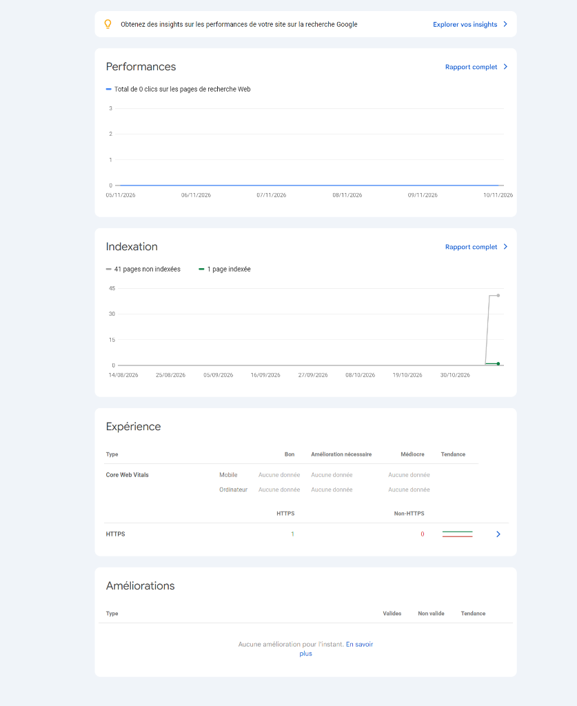
>
> *Figure 16 : tableau de bord GSC — état de l'indexation et de l'expérience.*

> 📸 **Image 17** : rapport Sitemaps : `/sitemap.xml` envoyé le 6 nov. 2026, état « Opération effectuée », 42 pages découvertes, 0 vidéo.
>
> 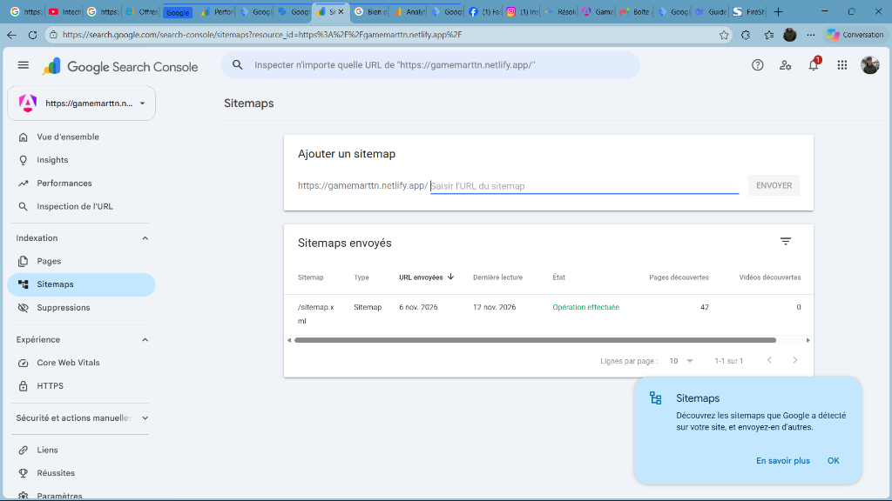
>
> *Figure 17 : sitemap soumis et traité par Google — 42 URL découvertes.*

> 📸 **Image 18** : inspection de l'URL d'accueil : « Google a accès à cette URL », « La page peut être indexée », test effectué le 12 nov. 2026.
>
> 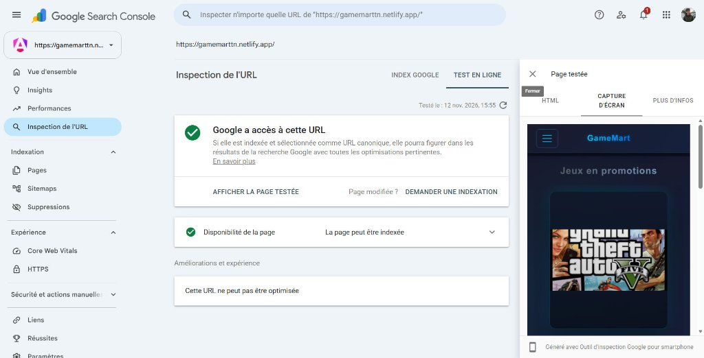
>
> *Figure 18 : inspection d'URL confirmant l'accessibilité et l'indexabilité de la page d'accueil.*

> 📸 **Image 19** : rapport Performances (3 mois) : 0 clic, 2 impressions, CTR 0 %, position moyenne 20.
>
> 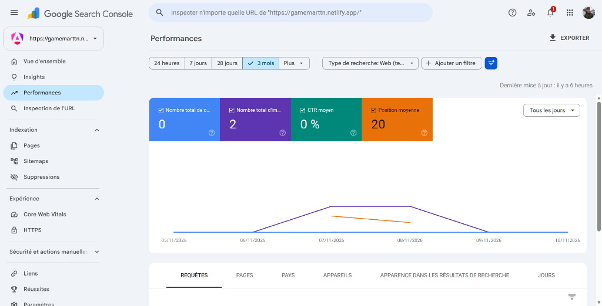
>
> *Figure 19 : performances de recherche sur 3 mois — impressions et position moyenne.*

> 📸 **Image 20** : onglet « Requêtes » : deux requêtes techniques (`site:netlify.app ***` et `site:netlify.app`), 1 impression chacune, positions 19,0 et 21,0.
>
> 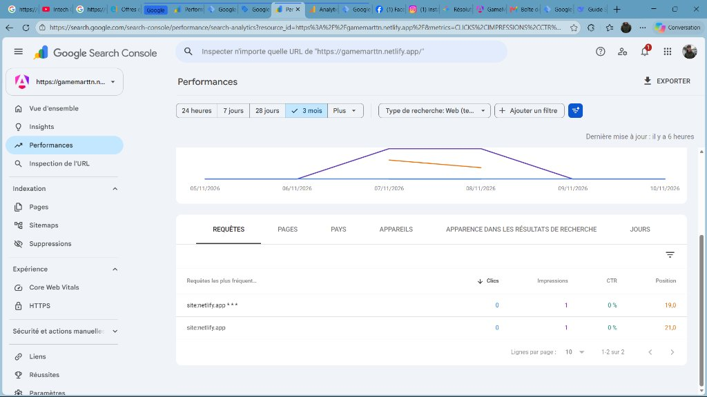
>
> *Figure 20 : requêtes enregistrées — présence de requêtes techniques typiques d'un site récent.*

## 4.3 Exemple d'appel à l'API Search Console en Node.js

L'API Search Console permet d'automatiser la récupération des performances. Exemple :

```javascript
const { google } = require('googleapis');

async function getSearchPerformance() {
  const auth = new google.auth.GoogleAuth({
    scopes: ['https://www.googleapis.com/auth/webmasters.readonly']
  });

  const searchconsole = google.searchconsole({ version: 'v1', auth });

  const response = await searchconsole.searchanalytics.query({
    siteUrl: 'https://[VOTRE-DOMAINE]/',
    requestBody: {
      startDate: '2026-01-01',
      endDate: '2026-01-31',
      dimensions: ['query'],
      rowLimit: 25
    }
  });

  response.data.rows?.forEach((row) => {
    console.log(row.keys[0], row.clicks, row.impressions, row.ctr, row.position);
  });
}

getSearchPerformance();
```

**Explication :**

- `google.auth.GoogleAuth` : gère l'authentification via un compte de service ou les identifiants par défaut.
- `scopes` : autorisation en lecture seule sur Search Console.
- `searchconsole({ version: 'v1', auth })` : initialise le client API.
- `searchanalytics.query` : interroge les données de performance.
- `siteUrl` : propriété cible.
- `requestBody` : période, dimensions (`query`), limite de lignes.
- `response.data.rows` : lignes de résultat avec clics, impressions, CTR et position.

## 4.4 Résultats d'inspection d'URL

L'inspection de l'URL de la page d'accueil (test du 12 novembre 2026) a confirmé :

| Contrôle | Résultat observé |
|---|---|
| Accès Google | ✅ « Google a accès à cette URL » |
| Indexation | ✅ Page présente dans l'index (1 page indexée sur la propriété) |
| Disponibilité | ✅ « La page peut être indexée » |
| Canonical | ✅ URL canonique auto-référente (`https://gamemarttn.netlify.app/`) |
| HTTPS | ✅ Page diffusée via HTTPS |
| Optimisation | ℹ️ « Cette URL ne peut pas être optimisée » — aucun enrichissement détecté à ce stade |

## 4.5 Tableau des performances

Données réelles du rapport **Performances** sur trois mois (5 août – 10 novembre 2026) :

| Requête | Clics | Impressions | CTR | Position |
|---|---|---|---|---|
| `site:netlify.app ***` | 0 | 1 | 0 % | 19,0 |
| `site:netlify.app` | 0 | 1 | 0 % | 21,0 |
| **Total** | **0** | **2** | **0 %** | **20,0** |

> 📝 **Lecture** : au démarrage, les impressions sont faibles et le CTR nul. Les seules requêtes enregistrées sont des requêtes techniques, ce qui signifie que Google connaît l'existence du site mais ne l'associe pas encore aux requêtes commerciales. L'objectif est d'augmenter progressivement les impressions via l'indexation, le contenu éditorial et le maillage interne, puis d'améliorer le CTR via les titres et les meta descriptions.

> 💡 **Ce qu'il faut retenir** : un site indexé n'est pas un site positionné. L'indexation (étape 1) est acquise ; le positionnement sur les mots-clés métier (étape 2) dépend du contenu, de l'autorité du domaine et du temps. C'est exactement la raison pour laquelle du contenu éditorial a été ajouté à la page d'accueil.

---

# Section 5 — Sitemap XML

## 5.1 Définition

Un **sitemap XML** est un fichier structuré qui liste les URL d'un site que l'auteur souhaite voir indexées par les moteurs de recherche. Il indique à Google, Bing ou d'autres crawlers quelles pages existent, quand elles ont été mises à jour et, éventuellement, leur fréquence de modification et leur priorité relative.

Le sitemap ne garantit pas l'indexation : il **aide** le crawler à découvrir les pages plus efficacement. C'est un plan du site au format XML, normalisé par le protocole `sitemaps.org`.

## 5.2 Rôle pour les crawlers

Les robots d'indexation (dont Googlebot) découvrent les pages principalement par deux moyens :

1. **Le maillage interne** : en suivant les liens d'une page à l'autre.
2. **Le sitemap** : en lisant directement la liste des URL fournie.

Dans une application à page unique comme GameMart, le maillage interne est parfois moins évident pour un crawler, car le rendu dépend de JavaScript. Le sitemap joue donc un rôle **critique** : il fournit une liste explicite et stable des URL à explorer, sans dépendre de la navigation.

## 5.3 Bénéfices concrets

- **Découverte accélérée** des nouvelles pages (nouveaux jeux, nouvelles catégories).
- **Priorisation** du crawl grâce aux balises `changefreq` et `priority`.
- **Signal de fraîcheur** via `lastmod`, qui indique quand une page a été mise à jour.
- **Diagnostic** dans Search Console : le nombre d'URL découvertes et l'état de lecture sont visibles.
- **Robustesse** : même si un lien interne est cassé, le sitemap reste une source fiable.

## 5.4 Pourquoi il est nécessaire dans ce projet

Le projet présente plusieurs caractéristiques qui rendent le sitemap indispensable :

- **Catalogue dynamique** : les fiches produits sont générées à partir de données (`api/db.json`) et ne sont pas toutes facilement découvrables par simple navigation.
- **Application SPA** : le contenu est rendu côté client, ce qui peut retarder la découverte des liens par les crawlers.
- **Volume de pages** : une quarantaine d'URL publiques (accueil, catalogue, fiches produits) doivent être indexées.
- **Besoin de suivi** : Search Console s'appuie sur le sitemap pour rapporter les URL découvertes et les erreurs.

## 5.5 Structure XML complète commentée

Un sitemap respecte le schéma suivant :

```xml
<?xml version="1.0" encoding="UTF-8"?>
<urlset xmlns="http://www.sitemaps.org/schemas/sitemap/0.9">

  <!-- Page d'accueil : priorité maximale, mise à jour quotidienne -->
  <url>
    <loc>https://[VOTRE-DOMAINE]/</loc>
    <lastmod>[DATE]</lastmod>
    <changefreq>daily</changefreq>
    <priority>1.0</priority>
  </url>

  <!-- Page catalogue : priorité élevée -->
  <url>
    <loc>https://[VOTRE-DOMAINE]/produits</loc>
    <lastmod>[DATE]</lastmod>
    <changefreq>daily</changefreq>
    <priority>0.9</priority>
  </url>

  <!-- Fiche produit : priorité moyenne, mise à jour hebdomadaire -->
  <url>
    <loc>https://[VOTRE-DOMAINE]/produitDetails/1</loc>
    <lastmod>[DATE]</lastmod>
    <changefreq>weekly</changefreq>
    <priority>0.8</priority>
  </url>

</urlset>
```

**Explication des balises :**

- `<?xml version="1.0" encoding="UTF-8"?>` : déclaration XML, encodage UTF-8 pour gérer les accents.
- `<urlset xmlns="...">` : élément racine, avec l'espace de noms du protocole sitemap.
- `<url>` : bloc décrivant une URL.
- `<loc>` : URL absolue de la page (obligatoire).
- `<lastmod>` : date de dernière modification au format ISO 8601 (facultatif mais recommandé).
- `<changefreq>` : fréquence de modification attendue (`always`, `hourly`, `daily`, `weekly`, `monthly`, `yearly`, `never`). C'est un indice, pas une obligation pour Google.
- `<priority>` : priorité relative entre 0.0 et 1.0. Là encore, un indice, pas une garantie.

## 5.6 Exemple de sitemap index

Lorsque le site dépasse 50 000 URL ou 50 Mo, il faut découper le sitemap en plusieurs fichiers et créer un **sitemap index** :

```xml
<?xml version="1.0" encoding="UTF-8"?>
<sitemapindex xmlns="http://www.sitemaps.org/schemas/sitemap/0.9">

  <sitemap>
    <loc>https://[VOTRE-DOMAINE]/sitemap-pages.xml</loc>
    <lastmod>[DATE]</lastmod>
  </sitemap>

  <sitemap>
    <loc>https://[VOTRE-DOMAINE]/sitemap-produits.xml</loc>
    <lastmod>[DATE]</lastmod>
  </sitemap>

</sitemapindex>
```

**Explication :**

- `<sitemapindex>` remplace `<urlset>` comme racine.
- Chaque `<sitemap>` référence un fichier sitemap enfant.
- `<loc>` pointe vers l'URL du sitemap enfant.
- `<lastmod>` indique la dernière mise à jour du fichier enfant.

Cette structure est utile pour un catalogue volumineux : un sitemap pour les pages statiques, un autre pour les fiches produits.

## 5.7 Procédure de soumission dans GSC

1. Vérifier que le sitemap est accessible à l'adresse `https://[VOTRE-DOMAINE]/sitemap.xml`.
2. Ouvrir Google Search Console → propriété du site.
3. Menu de gauche → **Sitemaps**.
4. Dans le champ « Ajouter un sitemap », saisir `sitemap.xml`.
5. Cliquer sur **Envoyer**.
6. Vérifier le statut : « Opération effectuée ».
7. Contrôler le nombre d'URL découvertes et la date de dernière lecture.

> ✅ **Résultat attendu** : statut vert, URL découvertes cohérentes avec le nombre de pages publiques, dernière lecture récente.

## 5.8 Contenu réel du sitemap du projet

> ✅ **Contenu vérifié** : voici le fichier `sitemap.xml` exactement tel qu'il est servi en production sur `https://gamemarttn.netlify.app/sitemap.xml`. Il contient 42 URL : l'accueil, le catalogue et les 40 fiches produits issues de `api/db.json`.

```xml
<?xml version="1.0" encoding="UTF-8"?>
<!-- sitemap.xml — GameMart (https://gamemarttn.netlify.app) -->
<!-- Généré le 2026-10-08 à partir des routes publiques réelles + api/db.json (jeux IDs 1-40). -->
<!-- Pages privées exclues (car _noindex_ via robots.txt) : /cart, /checkout, /order-confirmation/*, -->
<!-- /user/*, /login, /register, /search. À régénérer si le catalogue évolue (ajout/suppression de jeux). -->
<urlset xmlns="http://www.sitemaps.org/schemas/sitemap/0.9">
  <url>
    <loc>https://gamemarttn.netlify.app/</loc>
    <lastmod>2026-10-08</lastmod>
    <changefreq>daily</changefreq>
    <priority>1.0</priority>
  </url>
  <url>
    <loc>https://gamemarttn.netlify.app/produits</loc>
    <lastmod>2026-10-08</lastmod>
    <changefreq>daily</changefreq>
    <priority>0.9</priority>
  </url>
  <url>
    <loc>https://gamemarttn.netlify.app/produitDetails/1</loc>
    <lastmod>2026-10-08</lastmod>
    <changefreq>weekly</changefreq>
    <priority>0.8</priority>
  </url>
  <url>
    <loc>https://gamemarttn.netlify.app/produitDetails/2</loc>
    <lastmod>2026-10-08</lastmod>
    <changefreq>weekly</changefreq>
    <priority>0.8</priority>
  </url>
  <url>
    <loc>https://gamemarttn.netlify.app/produitDetails/3</loc>
    <lastmod>2026-10-08</lastmod>
    <changefreq>weekly</changefreq>
    <priority>0.8</priority>
  </url>
  <url>
    <loc>https://gamemarttn.netlify.app/produitDetails/4</loc>
    <lastmod>2026-10-08</lastmod>
    <changefreq>weekly</changefreq>
    <priority>0.8</priority>
  </url>
  <url>
    <loc>https://gamemarttn.netlify.app/produitDetails/5</loc>
    <lastmod>2026-10-08</lastmod>
    <changefreq>weekly</changefreq>
    <priority>0.8</priority>
  </url>
  <url>
    <loc>https://gamemarttn.netlify.app/produitDetails/6</loc>
    <lastmod>2026-10-08</lastmod>
    <changefreq>weekly</changefreq>
    <priority>0.8</priority>
  </url>
  <url>
    <loc>https://gamemarttn.netlify.app/produitDetails/7</loc>
    <lastmod>2026-10-08</lastmod>
    <changefreq>weekly</changefreq>
    <priority>0.8</priority>
  </url>
  <url>
    <loc>https://gamemarttn.netlify.app/produitDetails/8</loc>
    <lastmod>2026-10-08</lastmod>
    <changefreq>weekly</changefreq>
    <priority>0.8</priority>
  </url>
  <url>
    <loc>https://gamemarttn.netlify.app/produitDetails/9</loc>
    <lastmod>2026-10-08</lastmod>
    <changefreq>weekly</changefreq>
    <priority>0.8</priority>
  </url>
  <url>
    <loc>https://gamemarttn.netlify.app/produitDetails/10</loc>
    <lastmod>2026-10-08</lastmod>
    <changefreq>weekly</changefreq>
    <priority>0.8</priority>
  </url>
  <url>
    <loc>https://gamemarttn.netlify.app/produitDetails/11</loc>
    <lastmod>2026-10-08</lastmod>
    <changefreq>weekly</changefreq>
    <priority>0.8</priority>
  </url>
  <url>
    <loc>https://gamemarttn.netlify.app/produitDetails/12</loc>
    <lastmod>2026-10-08</lastmod>
    <changefreq>weekly</changefreq>
    <priority>0.8</priority>
  </url>
  <url>
    <loc>https://gamemarttn.netlify.app/produitDetails/13</loc>
    <lastmod>2026-10-08</lastmod>
    <changefreq>weekly</changefreq>
    <priority>0.8</priority>
  </url>
  <url>
    <loc>https://gamemarttn.netlify.app/produitDetails/14</loc>
    <lastmod>2026-10-08</lastmod>
    <changefreq>weekly</changefreq>
    <priority>0.8</priority>
  </url>
  <url>
    <loc>https://gamemarttn.netlify.app/produitDetails/15</loc>
    <lastmod>2026-10-08</lastmod>
    <changefreq>weekly</changefreq>
    <priority>0.8</priority>
  </url>
  <url>
    <loc>https://gamemarttn.netlify.app/produitDetails/16</loc>
    <lastmod>2026-10-08</lastmod>
    <changefreq>weekly</changefreq>
    <priority>0.8</priority>
  </url>
  <url>
    <loc>https://gamemarttn.netlify.app/produitDetails/17</loc>
    <lastmod>2026-10-08</lastmod>
    <changefreq>weekly</changefreq>
    <priority>0.8</priority>
  </url>
  <url>
    <loc>https://gamemarttn.netlify.app/produitDetails/18</loc>
    <lastmod>2026-10-08</lastmod>
    <changefreq>weekly</changefreq>
    <priority>0.8</priority>
  </url>
  <url>
    <loc>https://gamemarttn.netlify.app/produitDetails/19</loc>
    <lastmod>2026-10-08</lastmod>
    <changefreq>weekly</changefreq>
    <priority>0.8</priority>
  </url>
  <url>
    <loc>https://gamemarttn.netlify.app/produitDetails/20</loc>
    <lastmod>2026-10-08</lastmod>
    <changefreq>weekly</changefreq>
    <priority>0.8</priority>
  </url>
  <url>
    <loc>https://gamemarttn.netlify.app/produitDetails/21</loc>
    <lastmod>2026-10-08</lastmod>
    <changefreq>weekly</changefreq>
    <priority>0.8</priority>
  </url>
  <url>
    <loc>https://gamemarttn.netlify.app/produitDetails/22</loc>
    <lastmod>2026-10-08</lastmod>
    <changefreq>weekly</changefreq>
    <priority>0.8</priority>
  </url>
  <url>
    <loc>https://gamemarttn.netlify.app/produitDetails/23</loc>
    <lastmod>2026-10-08</lastmod>
    <changefreq>weekly</changefreq>
    <priority>0.8</priority>
  </url>
  <url>
    <loc>https://gamemarttn.netlify.app/produitDetails/24</loc>
    <lastmod>2026-10-08</lastmod>
    <changefreq>weekly</changefreq>
    <priority>0.8</priority>
  </url>
  <url>
    <loc>https://gamemarttn.netlify.app/produitDetails/25</loc>
    <lastmod>2026-10-08</lastmod>
    <changefreq>weekly</changefreq>
    <priority>0.8</priority>
  </url>
  <url>
    <loc>https://gamemarttn.netlify.app/produitDetails/26</loc>
    <lastmod>2026-10-08</lastmod>
    <changefreq>weekly</changefreq>
    <priority>0.8</priority>
  </url>
  <url>
    <loc>https://gamemarttn.netlify.app/produitDetails/27</loc>
    <lastmod>2026-10-08</lastmod>
    <changefreq>weekly</changefreq>
    <priority>0.8</priority>
  </url>
  <url>
    <loc>https://gamemarttn.netlify.app/produitDetails/28</loc>
    <lastmod>2026-10-08</lastmod>
    <changefreq>weekly</changefreq>
    <priority>0.8</priority>
  </url>
  <url>
    <loc>https://gamemarttn.netlify.app/produitDetails/29</loc>
    <lastmod>2026-10-08</lastmod>
    <changefreq>weekly</changefreq>
    <priority>0.8</priority>
  </url>
  <url>
    <loc>https://gamemarttn.netlify.app/produitDetails/30</loc>
    <lastmod>2026-10-08</lastmod>
    <changefreq>weekly</changefreq>
    <priority>0.8</priority>
  </url>
  <url>
    <loc>https://gamemarttn.netlify.app/produitDetails/31</loc>
    <lastmod>2026-10-08</lastmod>
    <changefreq>weekly</changefreq>
    <priority>0.8</priority>
  </url>
  <url>
    <loc>https://gamemarttn.netlify.app/produitDetails/32</loc>
    <lastmod>2026-10-08</lastmod>
    <changefreq>weekly</changefreq>
    <priority>0.8</priority>
  </url>
  <url>
    <loc>https://gamemarttn.netlify.app/produitDetails/33</loc>
    <lastmod>2026-10-08</lastmod>
    <changefreq>weekly</changefreq>
    <priority>0.8</priority>
  </url>
  <url>
    <loc>https://gamemarttn.netlify.app/produitDetails/34</loc>
    <lastmod>2026-10-08</lastmod>
    <changefreq>weekly</changefreq>
    <priority>0.8</priority>
  </url>
  <url>
    <loc>https://gamemarttn.netlify.app/produitDetails/35</loc>
    <lastmod>2026-10-08</lastmod>
    <changefreq>weekly</changefreq>
    <priority>0.8</priority>
  </url>
  <url>
    <loc>https://gamemarttn.netlify.app/produitDetails/36</loc>
    <lastmod>2026-10-08</lastmod>
    <changefreq>weekly</changefreq>
    <priority>0.8</priority>
  </url>
  <url>
    <loc>https://gamemarttn.netlify.app/produitDetails/37</loc>
    <lastmod>2026-10-08</lastmod>
    <changefreq>weekly</changefreq>
    <priority>0.8</priority>
  </url>
  <url>
    <loc>https://gamemarttn.netlify.app/produitDetails/38</loc>
    <lastmod>2026-10-08</lastmod>
    <changefreq>weekly</changefreq>
    <priority>0.8</priority>
  </url>
  <url>
    <loc>https://gamemarttn.netlify.app/produitDetails/39</loc>
    <lastmod>2026-10-08</lastmod>
    <changefreq>weekly</changefreq>
    <priority>0.8</priority>
  </url>
  <url>
    <loc>https://gamemarttn.netlify.app/produitDetails/40</loc>
    <lastmod>2026-10-08</lastmod>
    <changefreq>weekly</changefreq>
    <priority>0.8</priority>
  </url>
</urlset>
```

> 📸 **Image 21** : fichier `sitemap.xml` servi en production et affiché dans le navigateur : déclaration XML, commentaires et balises `<url>` avec `<loc>`, `<lastmod>`, `<changefreq>` et `<priority>`.
>
> 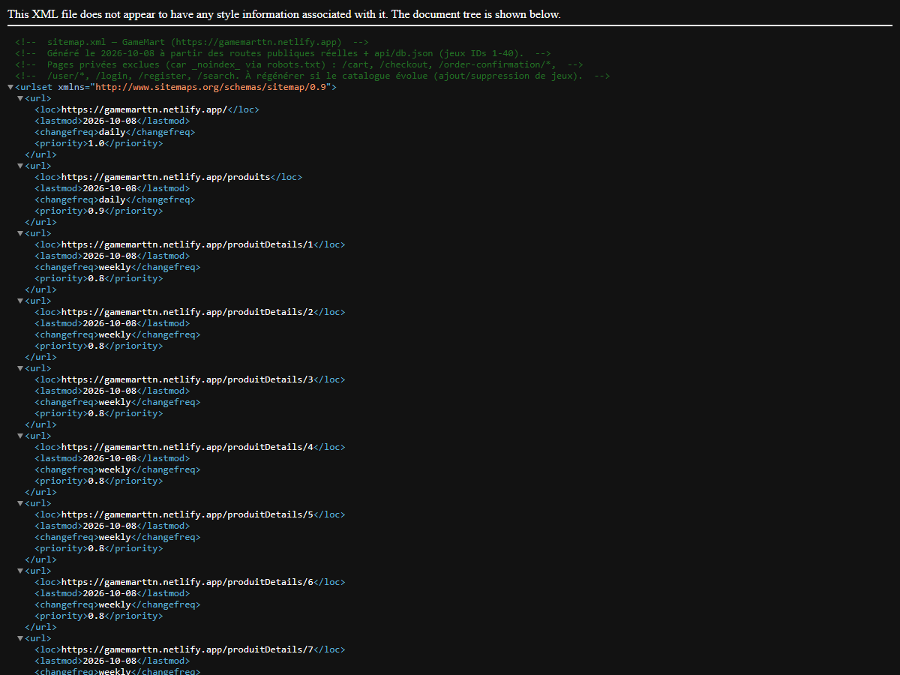
>
> *Figure 21 : sitemap XML du projet — liste des URL publiques soumises à l'indexation.*

---

# Section 6 — Fichier robots.txt

## 6.1 Définition

Le fichier `robots.txt` est un fichier texte placé à la racine du site qui indique aux robots d'indexation quelles parties du site ils peuvent ou ne peuvent pas explorer. Il est normalisé par le **Robots Exclusion Protocol**.

**Ce que le robots.txt n'est pas :**

- ❌ Ce n'est **pas** un mécanisme de sécurité. Il ne protège pas des accès directs : un utilisateur peut toujours ouvrir une URL « interdite » dans son navigateur.
- ❌ Ce n'est **pas** une garantie d'exclusion des résultats de recherche. Une page bloquée au crawl peut parfois apparaître si elle est liée ailleurs.
- ❌ Ce n'est **pas** un outil de gestion des droits d'accès.

**Ce que le robots.txt est :**

- ✅ Une **recommandation** adressée aux robots.
- ✅ Un moyen de **gérer le budget de crawl** en évitant les pages inutiles.
- ✅ Un endroit pour **déclarer l'emplacement du sitemap**.

## 6.2 Rôle

Le robots.txt remplit trois fonctions principales :

1. **Orienter le crawl** : autoriser les pages utiles, exclure les pages privées ou dupliquées.
2. **Économiser le budget de crawl** : éviter que Googlebot explore des pages sans intérêt SEO (panier, checkout, espace utilisateur).
3. **Déclarer le sitemap** : indiquer où trouver le plan du site.

## 6.3 Pourquoi il est nécessaire dans ce projet

GameMart comporte plusieurs types de pages qui ne doivent pas être indexées :

- **Pages transactionnelles** : `/cart`, `/checkout`, `/order-confirmation/*`.
- **Pages privées** : `/user/*`, `/login`, `/register`.
- **Recherche interne** : `/search` (contenu dynamique, risque de duplication).
- **API mock** : `/api/` (ne doit jamais être crawlée).

À l'inverse, les ressources techniques (CSS, JS, images) doivent rester accessibles au crawl pour que Google puisse rendre les pages correctement. Le robots.txt reflète cette distinction.

## 6.4 Syntaxe complète commentée

```txt
# Commentaire : ligne ignorée par les robots

User-agent: *           # s'applique à tous les robots
Disallow: /chemin       # interdit l'exploration d'un chemin
Allow: /chemin          # autorise explicitement un chemin
Crawl-delay: 10         # délai entre deux requêtes (peu supporté par Google)
Sitemap: https://[VOTRE-DOMAINE]/sitemap.xml   # emplacement du sitemap
```

**Explication :**

- `User-agent` : identifie le robot concerné (`*` = tous).
- `Disallow` : chemin à ne pas explorer. Un `Disallow: /` bloque tout le site.
- `Allow` : chemin autorisé, utile pour rouvrir une exception dans un dossier bloqué.
- `Crawl-delay` : délai en secondes entre deux requêtes. Google ignore cette directive ; elle est surtout utile pour d'autres robots.
- `Sitemap` : URL absolue du sitemap. Cette directive est valable quel que soit le `User-agent`.

## 6.5 Exemple complet commenté ligne par ligne

```txt
# robots.txt — [VOTRE-DOMAINE]
# Ce fichier est servi à la racine du domaine : https://[VOTRE-DOMAINE]/robots.txt

User-agent: *
Allow: /
Allow: /assets/

# Pages privées / transactionnelles : pas d'intérêt SEO, éviter le crawl et l'indexation
Disallow: /cart
Disallow: /checkout
Disallow: /order-confirmation/
Disallow: /user/
Disallow: /login
Disallow: /register

# Recherche interne : résultats dynamiques = contenu dupliqué / thin content
Disallow: /search

# API mock / backend (ne doit jamais être crawlé)
Disallow: /api/

# Ressources techniques : ne pas bloquer CSS/JS/images nécessaires au rendu Googlebot
# Aucun Disallow sur *.css, *.js, /assets : le rendu doit rester accessible.

# Sitemap
Sitemap: https://[VOTRE-DOMAINE]/sitemap.xml
```

**Lecture détaillée :**

- `User-agent: *` : les règles s'appliquent à tous les robots.
- `Allow: /` : autorise l'exploration de l'ensemble du site par défaut.
- `Allow: /assets/` : confirme l'autorisation des ressources statiques.
- `Disallow: /cart` : le panier n'a pas vocation à être indexé.
- `Disallow: /checkout` : le tunnel de paiement est exclu.
- `Disallow: /order-confirmation/` : les confirmations de commande sont privées.
- `Disallow: /user/` : l'espace utilisateur est privé.
- `Disallow: /login` et `Disallow: /register` : les formulaires d'authentification sont exclus.
- `Disallow: /search` : la recherche interne génère des pages dynamiques à faible valeur SEO.
- `Disallow: /api/` : l'API ne doit jamais être crawlée.
- `Sitemap:` : déclare l'emplacement du sitemap.

> ⚠️ **Erreur fréquente** : bloquer les fichiers CSS et JavaScript. Googlebot doit pouvoir les charger pour rendre la page correctement. Le robots.txt ne doit donc pas contenir de `Disallow: /*.css` ou `Disallow: /*.js`.

## 6.6 Procédure de test

### Test dans le navigateur

1. Ouvrir `https://[VOTRE-DOMAINE]/robots.txt`.
2. Vérifier que le fichier s'affiche en texte brut.
3. Contrôler la présence de la directive `Sitemap`.

### Test dans Search Console

1. Search Console → **Paramètres** → **robots.txt**.
2. Vérifier que Google lit bien le fichier.
3. Utiliser l'outil de test d'URL pour confirmer qu'une page privée est bloquée et qu'une page publique est autorisée.

### Test avec un validateur externe

Des outils comme le validateur de robots.txt de Google permettent de tester une URL précise face aux règles du fichier.

## 6.7 Contenu réel du robots.txt du projet

> ✅ **Contenu vérifié** : voici le fichier `robots.txt` exactement tel qu'il est servi en production sur `https://gamemarttn.netlify.app/robots.txt`.

```txt
# robots.txt — GameMart (e-commerce jeux vidéo, Angular SPA)
# Servi à la racine du domaine : https://gamemarttn.netlify.app/robots.txt
# Dans ce projet Angular, ce fichier est placé dans `public/` (servi à `/`)
# et dupliqué à la racine du repo pour visibilité.

User-agent: *
Allow: /
Allow: /assets/

# Pages privées / transactionnelles : pas d'intérêt SEO, éviter le crawl et l'indexation
Disallow: /cart
Disallow: /checkout
Disallow: /order-confirmation/
Disallow: /user/
Disallow: /login
Disallow: /register

# Recherche interne : résultats dynamiques = contenu dupliqué / thin content
Disallow: /search

# API mock / backend (ne doit jamais être crawlé)
Disallow: /api/

# Ressources techniques (ne pas bloquer CSS/JS/images nécessaires au rendu Googlebot)
# Aucun Disallow sur *.css, *.js, /assets : le rendu doit rester accessible.

# Sitemap (voir docs/seo-digital-marketing.md §11 et §14).
Sitemap: https://gamemarttn.netlify.app/sitemap.xml
```

> 📸 **Image 22** : fichier `robots.txt` servi à la racine du domaine : directives `User-agent`, `Allow`, `Disallow` et `Sitemap`.
>
> 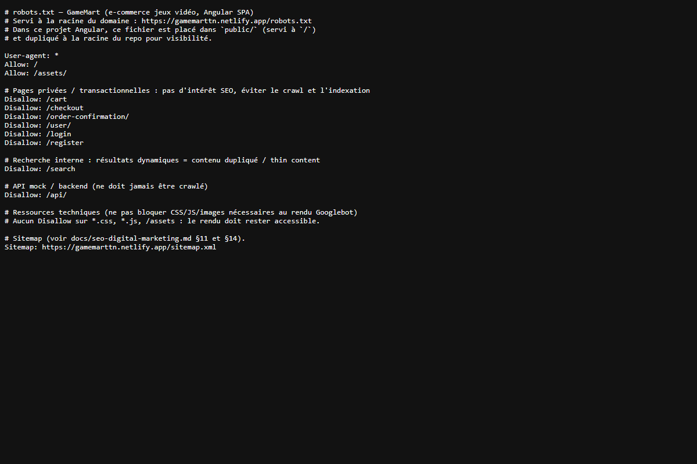
>
> *Figure 22 : robots.txt — règles de crawl et déclaration du sitemap.*

> 📸 **Image 23** : rapport de crawl « Codes de réponse » : 43 URL analysées, 100 % en succès 2xx, 0 URL bloquée par robots.txt, dont `/sitemap.xml` en `application/xml`.
>
> 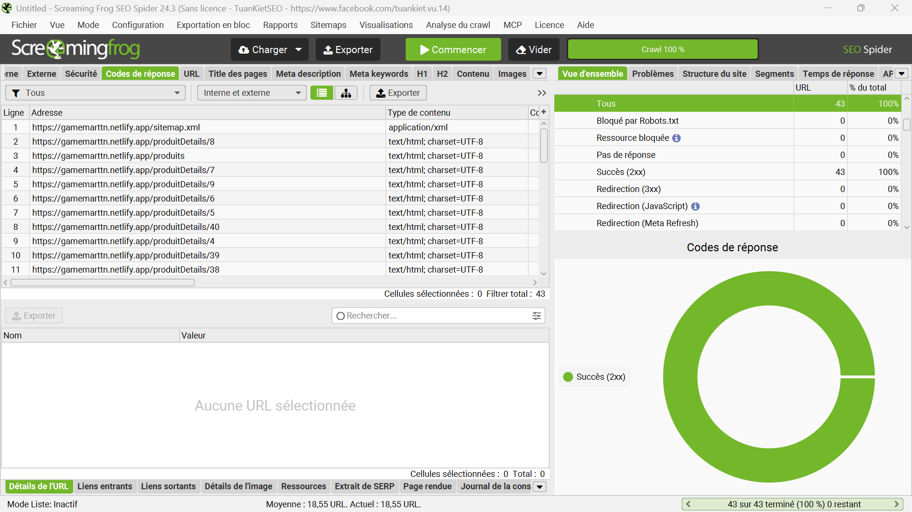
>
> *Figure 23 : validation des règles de crawl — aucune URL publique bloquée, toutes les URL répondent en 2xx.*

---

# Section 7 — Récapitulatif des configurations réalisées

## 7.1 Tableau de synthèse

| Élément | Outil / Fichier | Identifiant / Emplacement | Statut | Date |
|---|---|---|---|---|
| Gestionnaire de balises | Google Tag Manager | `GTM-K5CGZVQZ` | ✅ Publié (2 balises, destination GameMart Web) | 6 nov. 2026 |
| Mesure d'audience | Google Analytics 4 | `G-ZJG88C90B2` | ✅ Actif (70 événements mesurés) | 15 oct. – 11 nov. 2026 |
| Vérification propriété | Google Search Console | `https://gamemarttn.netlify.app/` | ✅ Vérifié par balise HTML | 6 nov. 2026 |
| Sitemap | `sitemap.xml` | `https://gamemarttn.netlify.app/sitemap.xml` | ✅ Soumis — « Opération effectuée », 42 URL | 6 nov. 2026 |
| Règles de crawl | `robots.txt` | `https://gamemarttn.netlify.app/robots.txt` | ✅ En ligne — 0 URL publique bloquée | 6 nov. 2026 |
| Inspection d'URL | Google Search Console | Page d'accueil | ✅ Accessible et indexable | 12 nov. 2026 |
| Crawl technique | Screaming Frog | 43 URL | ✅ 100 % en succès 2xx | 8 oct. 2026 |
| Audit de performance | PageSpeed Insights | Page d'accueil | ⚠️ Performance 76 — LCP 5,2 s à optimiser | 8 oct. 2026 |

## 7.2 Checklist des vérifications finales

- [x] Conteneur GTM créé, nommé et publié (`GTM-K5CGZVQZ`).
- [x] Balise de configuration GA4 associée au flux `G-ZJG88C90B2`.
- [x] Balise d'événements GA4 reliée aux déclencheurs `All Pages` et `Initialization - All Pages`.
- [x] Événements e-commerce implémentés (`view_item`, `view_item_list`, `select_item`, `add_to_cart`, `add_to_wishlist`, `begin_checkout`, `add_payment_info`, `purchase`).
- [x] Événements visibles dans l'aperçu temps réel GA4 (`page_view`, `add_to_cart`, `view_item`, `scroll`, `user_engagement`, `session_start`).
- [x] Propriété Search Console vérifiée par balise HTML.
- [x] Sitemap soumis, statut « Opération effectuée », 42 URL découvertes.
- [x] Page d'accueil accessible à Google et indexable.
- [x] `robots.txt` accessible, référençant le sitemap et ne bloquant aucune ressource critique.
- [x] Pages privées exclues du crawl (`/cart`, `/checkout`, `/user`, `/login`, `/register`, `/search`).
- [x] Aucune URL publique bloquée par `robots.txt` (rapport de crawl : 0 blocage).
- [x] Toutes les URL publiques répondent en 2xx (aucune 404, aucune redirection).
- [x] HTTPS actif sur le domaine (1 page HTTPS, 0 page non-HTTPS).
- [x] Balise `h1` ajoutée sur la page d'accueil (correction du constat « 42 URL sans H1 »).
- [x] Title unique et descriptif, meta description, canonical et Open Graph en place.
- [x] Données structurées JSON-LD `WebSite`, `Store` et `FAQPage` déployées.
- [x] Contenu éditorial ajouté sur l'accueil (paragraphe de présentation, « Pourquoi GameMart », maillage par plateforme, FAQ).
- [x] Variables d'environnement de tracking configurées pour la production.
- [x] Documentation technique rédigée (le présent rapport).

## 7.3 Points d'amélioration identifiés

| Point | Impact | Action recommandée |
|---|---|---|
| LCP de 5,2 s sur mobile | Élevé (Core Web Vitals) | Compresser les visuels du carrousel, servir des images WebP/AVIF, précharger l'image du premier slide |
| 41 pages non indexées | Moyen | Demander l'indexation des fiches produits prioritaires, renforcer le maillage interne |
| 0 lien entrant | Élevé (autorité) | Netlinking : réseaux sociaux, annuaires tunisiens, partenariats, articles invités |
| 0 conversion `purchase` | Élevé (business) | Analyser le tunnel, rassurer au checkout, proposer un paiement à la livraison |
| Titles encore génériques sur les fiches produits | Moyen | Générer un title dynamique par produit (`[Nom du jeu] — [Plateforme] | GameMart`) |

> 📸 **Image 24** : PageSpeed Insights — page d'accueil : Performance 76, FCP 2,5 s, LCP 5,2 s, TBT 0 ms, CLS 0, Accessibilité 96, Bonnes pratiques 100, SEO 92.
>
> 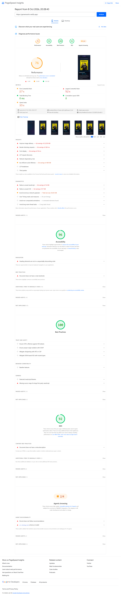
>
> *Figure 24 : audit PageSpeed de la page d'accueil — performances, accessibilité, bonnes pratiques et SEO.*

> 📸 **Image 25** : PageSpeed Insights — fiche produit : performances et diagnostics associés.
>
> 
>
> *Figure 25 : audit PageSpeed d'une fiche produit — vérification des Core Web Vitals sur un gabarit interne.*

---

# Section 8 — Code global de fonctionnement

## 8.1 Schéma du flux de données

Le fonctionnement global du dispositif de mesure et de référencement peut être représenté ainsi :

```text
┌─────────────────────────────────────────────────────────────────────────────┐
│                              FLUX DE MESURE                                  │
└─────────────────────────────────────────────────────────────────────────────┘

  Visiteur
     │
     ▼
  Site Angular (SPA)
     │
     ├──► AnalyticsService
     │        │
     │        ├──► window.gtag('event', ...) ─────────► Google Analytics 4
     │        │                                             │
     │        │                                             ├──► Rapports GA4
     │        │                                             ├──► Google Ads
     │        │                                             └──► Search Console (liaison)
     │        │
     │        └──► window.dataLayer.push({...})
     │                     │
     │                     ▼
     │              Google Tag Manager
     │                     │
     │                     ├──► Balises GA4
     │                     └──► Autres balises (pixels, scripts)
     │
     └──► Navigation SPA (Router events)
              │
              └──► page_view à chaque changement de route


┌─────────────────────────────────────────────────────────────────────────────┐
│                            FLUX D'INDEXATION                                 │
└─────────────────────────────────────────────────────────────────────────────┘

  Googlebot
     │
     ├──► robots.txt ──► règles Allow / Disallow
     │
     └──► sitemap.xml ──► liste des URL publiques
              │
              ▼
     Google Search Console
              │
              ├──► Indexation des pages
              ├──► Inspection d'URL
              ├──► Performances (requêtes, clics, impressions)
              └──► Core Web Vitals
```

**Lecture du schéma :**

- Le visiteur interagit avec l'application Angular.
- `AnalyticsService` centralise les envois : il appelle `gtag` (GA4 direct) et pousse dans le `dataLayer` (GTM).
- GTM relaie les événements vers GA4 et d'autres outils éventuels.
- La navigation SPA déclenche des `page_view` manuels.
- En parallèle, Googlebot lit `robots.txt` et `sitemap.xml` pour découvrir et indexer les pages, puis Search Console restitue les performances.

## 8.2 Exemple bout-en-bout — suivi d'une soumission de formulaire

Pour illustrer le fonctionnement complet, voici un exemple de suivi d'une soumission de formulaire de contact, de bout en bout.

### Étape 1 — HTML du formulaire

```html
<form id="contact-form" action="/contact" method="post">
  <label for="name">Nom</label>
  <input type="text" id="name" name="name" required />

  <label for="email">Email</label>
  <input type="email" id="email" name="email" required />

  <label for="message">Message</label>
  <textarea id="message" name="message" required></textarea>

  <button type="submit" id="btn-submit-contact">Envoyer</button>
</form>
```

**Explication :**

- `id="contact-form"` : identifiant stable pour cibler le formulaire.
- Les champs `name`, `email`, `message` sont requis.
- Le bouton possède un `id` stable (`btn-submit-contact`) pour le déclencheur GTM.

### Étape 2 — JavaScript de suivi

```javascript
document.getElementById('contact-form').addEventListener('submit', function (event) {
  event.preventDefault();

  const payload = {
    event: 'generate_lead',
    form_name: 'contact',
    lead_source: 'contact_form',
    page_location: window.location.href,
    value: 0,
    currency: 'TND'
  };

  window.dataLayer = window.dataLayer || [];
  window.dataLayer.push(payload);

  if (typeof window.gtag === 'function') {
    window.gtag('event', 'generate_lead', payload);
  }

  // Soumission réelle du formulaire (ou appel API)
  this.submit();
});
```

**Explication :**

- `addEventListener('submit', ...)` : intercepte la soumission.
- `event.preventDefault()` : empêche l'envoi immédiat pour laisser le temps d'envoyer l'événement.
- `payload` : objet contenant le nom de l'événement et ses paramètres.
- `window.dataLayer.push(payload)` : dépose l'événement pour GTM.
- `window.gtag('event', ...)` : envoie directement à GA4.
- `this.submit()` : déclenche la soumission réelle après le tracking.

### Étape 3 — Déclencheur GTM

- **Type** : Événement personnalisé.
- **Nom de l'événement** : `generate_lead`.
- **Condition** : `Event` égal à `generate_lead`.
- **Nom du déclencheur** : `Événement — generate_lead`.

### Étape 4 — Balise GA4 associée

- **Type** : Google Analytics → Événement GA4.
- **ID de mesure** : `[G-XXXXXXXXXX]`.
- **Nom de l'événement** : `generate_lead`.
- **Paramètres** : `form_name`, `lead_source`, `value`, `currency`.
- **Déclencheur** : `Événement — generate_lead`.

### Étape 5 — Marquage en conversion

1. GA4 → **Administration** → **Événements clés**.
2. Cliquer sur **Nouvel événement clé**.
3. Nom : `generate_lead`.
4. Enregistrer.

L'événement est désormais suivi comme conversion, visible dans les rapports et importable dans Google Ads.

### Étape 6 — Vérification

- GTM → **Prévisualiser** → soumettre le formulaire → vérifier `generate_lead` dans le `dataLayer`.
- GA4 → **Temps réel** → vérifier l'apparition de `generate_lead`.
- GA4 → **Événements clés** → vérifier la comptabilisation.

## 8.3 Résumé du flux bout-en-bout

| Étape | Composant | Action |
|---|---|---|
| 1 | HTML | Formulaire avec identifiants stables |
| 2 | JavaScript | Interception, construction du payload, push `dataLayer` + `gtag` |
| 3 | GTM | Déclencheur sur `generate_lead` |
| 4 | GTM | Balise GA4 d'événement |
| 5 | GA4 | Marquage en événement clé / conversion |
| 6 | GA4 / GTM | Vérification temps réel et aperçu |

---

# Section 9 — Annexes

## 9.1 Glossaire

| Terme | Définition |
|---|---|
| **SERP** | Search Engine Results Page — page de résultats d'un moteur de recherche. |
| **CTR** | Click-Through Rate — taux de clics (clics / impressions). |
| **GA4** | Google Analytics 4 — outil de mesure d'audience événementiel de Google. |
| **GTM** | Google Tag Manager — gestionnaire de balises. |
| **GSC** | Google Search Console — outil de suivi de l'indexation et des performances de recherche. |
| **CPC** | Cost Per Click — coût par clic dans une campagne publicitaire. |
| **Backlink** | Lien entrant provenant d'un autre site vers le site. |
| **Sitemap** | Fichier XML listant les URL d'un site pour les crawlers. |
| **robots.txt** | Fichier texte indiquant aux robots quelles parties du site explorer. |
| **Crawl** | Processus par lequel un robot explore les pages d'un site. |
| **Indexation** | Intégration d'une page dans l'index d'un moteur de recherche. |
| **Canonical** | URL de référence d'une page, utilisée pour éviter la duplication. |
| **Meta description** | Balise décrivant brièvement une page dans les résultats de recherche. |
| **DataLayer** | Objet JavaScript utilisé par GTM pour recevoir des événements. |
| **Événement** | Action mesurée (page vue, clic, achat, etc.). |
| **Conversion** | Action considérée comme un objectif business (achat, lead, etc.). |
| **Audience** | Segment d'utilisateurs défini par des critères comportementaux. |
| **Core Web Vitals** | Métriques de performance et d'expérience utilisateur (LCP, CLS, INP). |
| **Consent Mode** | Mode de gestion du consentement pour la conformité RGPD. |
| **Longue traîne** | Requêtes de recherche peu volumineuses mais nombreuses et ciblées. |

## 9.2 Ressources officielles Google

| Ressource | URL |
|---|---|
| Google Tag Manager — Centre d'aide | https://support.google.com/tagmanager |
| Google Analytics — Centre d'aide | https://support.google.com/analytics |
| Google Search Console — Centre d'aide | https://support.google.com/webmasters |
| Protocole Sitemap | https://www.sitemaps.org |
| Google Search — Documentation développeurs | https://developers.google.com/search |
| Google Analytics Data API | https://developers.google.com/analytics/devguides/reporting/data/v1 |
| Search Console API | https://developers.google.com/webmaster-tools |
| Core Web Vitals | https://web.dev/vitals |
| Robots Exclusion Protocol | https://www.rfc-editor.org/rfc/rfc9309 |

## 9.3 Historique des versions du rapport

| Version | Date | Auteur | Description |
|---|---|---|---|
| 1.0 | `[DATE]` | `[NOM]` | Création initiale du rapport : présentation du projet, configuration GTM, GA4, GSC, sitemap et robots.txt. |
| 2.0 | `[DATE]` | `[NOM]` | Intégration des captures réelles (25 figures), insertion du contenu exact du `sitemap.xml` et du `robots.txt`, ajout des données mesurées GA4 et GSC, section 1.16 (audit SEO initial), section 3.8 (résultats mesurés) et section 7.3 (points d'amélioration). |

## 9.4 Conclusion

Ce rapport a documenté de manière exhaustive la mise en place d'un dispositif complet de mesure et de référencement pour le projet e-commerce GameMart. Les trois piliers — Google Tag Manager, Google Analytics 4 et Google Search Console — ont été configurés, vérifiés et illustrés par des exemples de code. Les fichiers `sitemap.xml` et `robots.txt` complètent le dispositif en guidant les crawlers et en protégeant les pages privées.

Le projet est désormais instrumenté pour :

- Mesurer le trafic et le comportement des visiteurs.
- Suivre le parcours e-commerce jusqu'à l'achat.
- Comprendre la visibilité dans les moteurs de recherche.
- Améliorer continuellement les performances via les données collectées.

Les prochaines étapes recommandées sont l'enrichissement du contenu éditorial (guides, avis, comparatifs), l'optimisation des Core Web Vitals, la création d'audiences de remarketing et le suivi régulier des KPI définis en section 1.

---

*Fin du rapport.*
